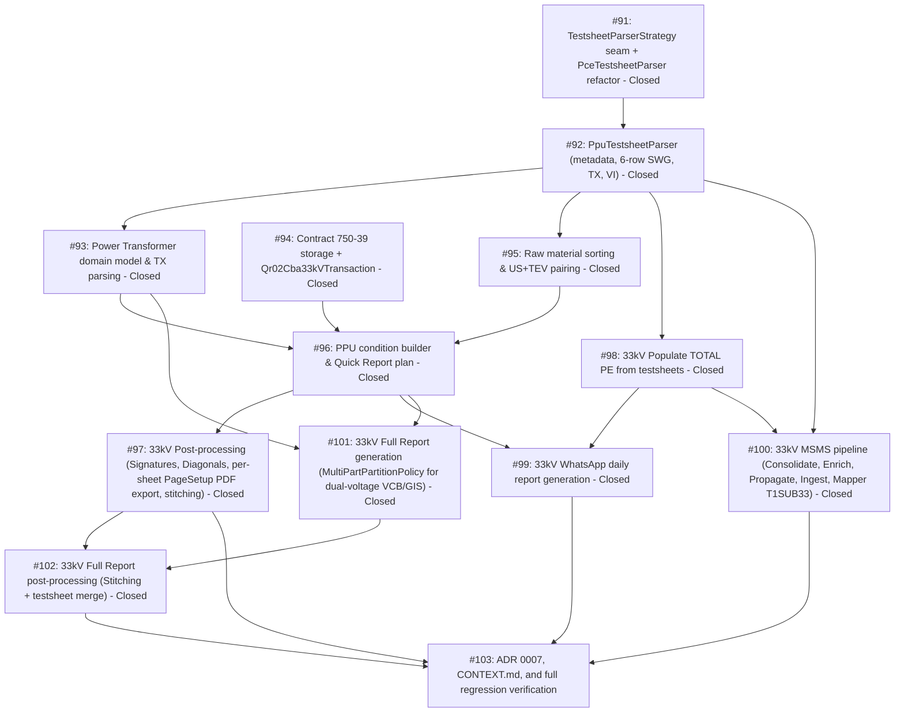

# 33kV System Workflow Expansion Index Map

> [!IMPORTANT]
> **Branching & QA Merge Policy**:
> - **Worktree & Feature Branch**: All implementation work across all tickets must be performed in the dedicated worktree `pahang-cli-33kv` on branch `feature/33kv-system` (branched from `main`).
> - **Active Project Directory**: `C:\Users\ADAM\Documents\PO 42394550 - PAHANG - 33kV - THUNDER` (Contract PO 42394550 - THUNDER).
> - **Isolation Invariant**: Under no circumstances should implementation commits be pushed directly to `main`.
> - **Merge Gate**: Merging `feature/33kv-system` back into `main` requires:
>   1. 100% green automated test suite (`pytest`) across all unit, adapter, workflow, and regression test suites.
>   2. Complete manual verification and CLI dry-run inspection approved by the human maintainer.
>   3. End-to-end dry run across all 14 workflows on real 33kV project data (THUNDER).

---

## Destination

Deliver an end-to-end, voltage-aware expansion across the Pahang CLI supporting 33kV sub-transmission and distribution projects (Contract PO 42394550 - THUNDER). Establishes a unified, voltage-polymorphic architecture across **all 14 actions** in the Project Workflow menu:
1. `Generate TESTSHEET Folder Structure`
2. `Populate TOTAL PE (from testsheets)` (syncing 33kV metadata into `TOTAL PE.xlsx` `DataCycle1`)
3. `Automate Raw Material Creation & Sorting (from Testsheets)` (PPU/PMU/SSU directory discovery, photo ranges, US+TEV multi-board discovery)
4. `Update QR02 CBA (from testsheets)` (`Qr02Cba33kVTransaction` for statewide contract 750-39 Columns G–R)
5. `Generate Quick Report` (`PpuSubstationConditionPairBuilderPolicy`, multi-voltage CBM defects, VI defect findings)
6. `Run Full Substation Post-Processing Pipeline (1-Click)` (signatures, diagonal borders, per-sheet PageSetup landscape/portrait PDF export, deliverable stitching `<STEM>.pdf`)
7. `Generate WhatsApp Report` (daily report rendering from 33kV Quick Reports and `TOTAL PE.xlsx`)
8. `Consolidate MSMS (PYTHON/MSMS/*.xls -> DATA MSMS)` (Maximo work order consolidation)
9. `Enrich MSMS (TOTAL PE -> DATA MSMS metadata)` (metadata enrichment)
10. `Propagate Work Orders (DATA MSMS -> TOTAL PE)` (WONUM propagation to `TOTAL PE.xlsx`)
11. `Ingest MSMS CSVs (RAW DATA -> TO BE FILLED)` (`T1SUB33` Maximo CSV ingestion)
12. `Populate Data MSMS (Testsheets -> TO BE FILLED CSVs)` (33kV `TestsheetReadingMapper` for online assessment meters)
13. `Generate Full Reports` (`MultiPartPartitionPolicy` for dual-voltage VCB/GIS cubicles and Power Transformers)
14. `Post-Process Full Reports (PDF + Testsheet Merge)` (multi-part batch PDF conversion, sequential stitching, testsheet merge into `<STEM>.pdf`)

Guarantees 100% backward compatibility and zero regressions across existing 11kV projects.

---

## Specification Reference

The authoritative specification for this effort is documented in [spec.md](./spec.md). It establishes the formal problem statement, user stories, core architectural decisions, testing seams, and out-of-scope boundaries. All tickets in this map implement vertical slices of this specification.

---

## Notes

- **Domain Model**: `TestsheetParserStrategy`, `PpuTestsheetParser`, `PceTestsheetParser`, `PowerTransformerSpec`, `SecondaryCompartmentRemarksPolicy`, `Qr02Cba33kVTransaction`, `PpuSubstationConditionPairBuilderPolicy`, `HighFidelityDocumentExportPolicy`, `ProjectEnvironment`, `MultiPartPartitionPolicy`.
- **Relevant Skills**: `tdd`, `codebase-design`, `caveman-commit`, `unslop`, `domain-modeling`.
- **Operating Invariant**: Existing 11kV testsheet formats (`PCE Testsheet`, `PCE VI`), contract 750-36 master workbooks, 11kV MSMS mappers, and 11kV Quick/Full Report templates must remain 100% functional without behavior alterations.
- **Shared Test Fixture Factory**: A shared PPU workbook fixture factory (`tests/fixtures/ppu_workbook_factory.py`) must be created to generate canonical 33kV workbooks with configurable panel counts, transformer ratings, and VI findings — reusable across all 33kV test files.
- **Naming Convention**: Only the newer 33kV sheet naming convention is targeted (`33kV (Main)`, `11kV (Main)`, `TX`, `Visual Inspec.` / `Visual Inspection`). The older `PMU-PPU-SSU Test Sheet (Main)` / `33kV (1)` convention from early fieldwork is superseded and out of scope.

---

## Work Breakdown & Phasing

---

## Tickets

### #91: feat(33kv-testsheet): TestsheetParserStrategy seam and PceTestsheetParser refactor
- **Status**: Closed
- **GitHub Issue**: [#91](https://github.com/adamlarGit/pahang-cli/issues/91)
- **Blocked by**: None (can start immediately)
- **Ticket File**: [tickets/091-testsheet-parser-strategy-seam.md](./tickets/091-testsheet-parser-strategy-seam.md)
- **Delivers**: Abstract `TestsheetParserStrategy` interface, refactored `PceTestsheetParser` wrapping all existing 11kV parsing logic with 100% backward compatibility, and voltage-routed parser factory.

### #92: feat(33kv-testsheet): PpuTestsheetParser for 33kV/11kV multi-sheet workbooks
- **Status**: Closed
- **GitHub Issue**: [#92](https://github.com/adamlarGit/pahang-cli/issues/92)
- **Blocked by**: #91
- **Ticket File**: [tickets/092-ppu-testsheet-parser.md](./tickets/092-ppu-testsheet-parser.md)
- **Delivers**: `PpuTestsheetParser` for 33kV workbooks parsing metadata (substation name, FL, date, type), dual-voltage switchgear lineups (6 physical sub-rows + Column Q SP: secondary panel), `Visual Inspec.` findings, RHS/LHS overview bays, `RAW DATA` photo bounds, and shared PPU workbook test fixture factory.

### #93: feat(33kv-domain): Power Transformer domain model and TX sheet parser
- **Status**: Closed
- **GitHub Issue**: [#93](https://github.com/adamlarGit/pahang-cli/issues/93)
- **Blocked by**: #92
- **Ticket File**: [tickets/093-secondary-panel-and-transformer-models.md](./tickets/093-secondary-panel-and-transformer-models.md)
- **Delivers**: `PowerTransformerSpec` model for $\ge 5$ MVA units with auxiliary thermals (`Marshalling Kiosk`, `Conservator Tank`, `Body`, `Cooling Fin`), TX sheet parser in `PpuTestsheetParser`, and transformer classification with warning on out-of-range ratings.

### #94: feat(33kv-master): Contract 750-39 storage resolution and Qr02Cba33kVTransaction
- **Status**: Closed
- **GitHub Issue**: [#94](https://github.com/adamlarGit/pahang-cli/issues/94)
- **Blocked by**: None (can start immediately, independent of #91/#92)
- **Ticket File**: [tickets/094-master-engr-750-39-and-qr02-transaction.md](./tickets/094-master-engr-750-39-and-qr02-transaction.md)
- **Delivers**: Statewide `ENGR-750-39 -CBA-PAHANG - {YEAR}.xlsx` storage path resolution (exact year match first, glob fallback with `ValueError` on ambiguity), `Qr02Cba33kVTransaction` handling Columns G–R, and QR03 defect lookup verification.

### #95: feat(33kv-raw): Raw material directory discovery and US+TEV multi-board archive extraction
- **Status**: Closed
- **GitHub Issue**: [#95](https://github.com/adamlarGit/pahang-cli/issues/95)
- **Blocked by**: #92
- **Ticket File**: [tickets/095-raw-material-sorting-and-us-tev-pairing.md](./tickets/095-raw-material-sorting-and-us-tev-pairing.md)
- **Delivers**: Substation directory stem matching for PPU/PMU/SSU naming conventions (in `src/project/storage.py`), IR/DG photo range copying from 33kV `RAW DATA` sheet, and US+TEV archive discovery for multi-board cubicles.

### #96: feat(33kv-quick-report): PPU/SSU condition photo pairing and multi-voltage Quick Report plan
- **Status**: Closed
- **GitHub Issue**: [#96](https://github.com/adamlarGit/pahang-cli/issues/96)
- **Blocked by**: #93, #94, #95
- **Ticket File**: [tickets/096-ppu-condition-builder-and-quick-report-plan.md](./tickets/096-ppu-condition-builder-and-quick-report-plan.md)
- **Delivers**: `PpuSubstationConditionPairBuilderPolicy` in `src/quick_report/substation_condition.py` (33kV/11kV switchgear, transformers, cable cellars, control panels, NER), multi-voltage CBM defect detail page generation iterating `switchgears` (plural) for dual-voltage packages, and VI defect detail callouts.

### #97: feat(33kv-postprocessing): 33kV pre-flight validation, signature alignment, diagonal borders, per-sheet PageSetup PDF export & deliverable stitching
- **Status**: Closed
- **GitHub Issue**: [#97](https://github.com/adamlarGit/pahang-cli/issues/97)
- **Blocked by**: #96
- **Ticket File**: [tickets/097-postprocessing-validation-and-pdf-export.md](./tickets/097-postprocessing-validation-and-pdf-export.md)
- **Delivers**: 33kV pre-flight validation rules, 33kV signature image anchor coordinates for 3 sheet layouts (Switchgear/TX/VI), diagonal borders range enforcement in `diagonal_borders.py` (Switchgear Rows 15–62 Cols C–U, TX Rows 7–70 Cols C–AB, VI unslashed), programmatic per-sheet PageSetup in `ComDocumentConverter` (Landscape A4 1mm margins for Switchgear/TX; Portrait A4 standard margins for VI; RAW DATA excluded), and consolidated `<STEM>.pdf` deliverable compilation.

### #98: feat(33kv-total-pe): Populate TOTAL PE from 33kV testsheets
- **Status**: Closed
- **GitHub Issue**: [#98](https://github.com/adamlarGit/pahang-cli/issues/98)
- **Blocked by**: #92
- **Ticket File**: [tickets/098-33kv-populate-total-pe.md](./tickets/098-33kv-populate-total-pe.md)
- **Delivers**: Voltage-aware `LocalExcelTotalPeRepository` adapter supporting 33kV testsheet packages extracted via `PpuTestsheetParser`, populating `DataCycle1` (`PE NO`, `FL NUMBER`, `SUBSTATION NAME`, `DATE`, `TYPE`, `WO`) with master `QR02 CBA` enrichment (Cols H & I), 2-digit/FL lookup keys, and 100% 11kV row-update parity.

### #99: feat(33kv-whatsapp): 33kV WhatsApp Daily Report generation
- **Status**: Closed
- **GitHub Issue**: [#99](https://github.com/adamlarGit/pahang-cli/issues/99)
- **Blocked by**: #96, #98
- **Ticket File**: [tickets/099-33kv-whatsapp-report.md](./tickets/099-33kv-whatsapp-report.md)
- **Delivers**: Voltage-aware WhatsApp daily report pipeline consolidating Quick Reports across multiple station directories per date, matching `TOTAL PE.xlsx` (`DataCycle1`), programmatically setting URLs and activity headers, dynamic multi-station grouping, and rendering `{NN}. {DD-MM-YYYY}.docx` to `PYTHON/WHATSAPP/`.

### #100: feat(33kv-msms): 33kV MSMS pipeline and TestsheetReadingMapper for T1SUB33
- **Status**: Closed
- **GitHub Issue**: [#100](https://github.com/adamlarGit/pahang-cli/issues/100)
- **Blocked by**: #92, #98
- **Ticket File**: [tickets/100-33kv-msms-pipeline.md](./tickets/100-33kv-msms-pipeline.md)
- **Delivers**: 33kV Maximo job plan `T1SUB33` support across MSMS pipeline, polymorphic `TestsheetReadingMapper` strategy (`PpuReadingMapper` across `33kV (Main)`, `11kV (Main)`, `TX`, `Visual Inspec.`), `TNBLOCATION` parent token resolution, and 100% parity with upstream consolidation, enrichment, and propagation.

### #101: feat(33kv-full-report): 33kV Full Report multi-part chunk generation
- **Status**: Closed
- **GitHub Issue**: [#101](https://github.com/adamlarGit/pahang-cli/issues/101)
- **Blocked by**: #93, #96
- **Ticket File**: [tickets/101-33kv-full-report-multipart-generation.md](./tickets/101-33kv-full-report-multipart-generation.md)
- **Delivers**: Expansion of `MultiPartPartitionPolicy` for 33kV dual-voltage VCB/GIS cubicles and Power Transformers: Part 01 Summary (Front page, Executive Summary Census, Visual Defect Summary, Switchgear Overview), Parts 02..N+1 (per-panel bay chunks with inline CBM defect pages across all lineups), Part N+2 (TX HV/LV sides via `tx-hv-sides.docx`/`tx-lv-sides.docx`, auxiliary thermals via `tx-overview.docx`, balance of plant, condition pages, visual defects, sticker page).

### #102: feat(33kv-full-report-postprocessing): 33kV Full Report multi-part PDF batch conversion, stitching, and testsheet merge
- **Status**: Closed
- **GitHub Issue**: [#102](https://github.com/adamlarGit/pahang-cli/issues/102)
- **Blocked by**: #97, #101
- **Ticket File**: [tickets/102-33kv-full-report-postprocessing.md](./tickets/102-33kv-full-report-postprocessing.md)
- **Delivers**: `FullReportPostProcessingWorkflow` execution on 33kV multi-part document chunks: batch Word COM PDF conversion, sequential part concatenation, and appended signed testsheet PDF merge into canonical deliverable `<STEM>.pdf`.

### #103: docs(33kv): Record ADR 0007, update CONTEXT.md, and e2e regression verification across all 14 workflows
- **Status**: Settled
- **GitHub Issue**: [#103](https://github.com/adamlarGit/pahang-cli/issues/103)
- **Blocked by**: #97, #99, #100, #102
- **Ticket File**: [tickets/103-docs-adr-and-e2e-regression-verification.md](./tickets/103-docs-adr-and-e2e-regression-verification.md)
- **Delivers**: ADR 0007 documenting the unified voltage-polymorphic architecture across all 14 actions, `CONTEXT.md` ubiquitous language additions, and complete regression test run verifying 0 failures across 11kV and 33kV test suites.

### #106: feat(msms): multi-tier substation matching and locked-file detection in Propagate Work Orders workflow
- **Status**: Closed
- **GitHub Issue**: [#106](https://github.com/adamlarGit/pahang-cli/issues/106)
- **Blocked by**: None
- **Ticket File**: [tickets/106-msms-multi-tier-matching.md](./tickets/106-msms-multi-tier-matching.md)
- **Delivers**: Multi-tier matching in PropagateWoFilter (FL -> Substation Name -> station token/date), locked-file preflight check on TOTAL PE.xlsx, and 100% (25/25) work order match rate on 33kV Thunder Cycle 4 dataset.

### #107: feat(msms): substation name matching and SAP FL synchronization in Enrich MSMS workflow
- **Status**: Closed
- **GitHub Issue**: [#107](https://github.com/adamlarGit/pahang-cli/issues/107)
- **Blocked by**: #106
- **Ticket File**: [tickets/107-enrich-msms-substation-name-matching.md](./tickets/107-enrich-msms-substation-name-matching.md)
- **Delivers**: Substation Name and station token fallback matching in EnrichMsmsFilter, SAP FL synchronization into Column E of DATA MSMS.xlsx, metadata enrichment into Columns D, F, G, and open/locked workbook preflight protection.

### #108: test(msms): end-to-end integration test and verification for 33kV workflows 8 through 12
- **Status**: Closed
- **GitHub Issue**: [#108](https://github.com/adamlarGit/pahang-cli/issues/108)
- **Blocked by**: #106, #107
- **Ticket File**: [tickets/108-msms-33kv-e2e-integration-tests.md](./tickets/108-msms-33kv-e2e-integration-tests.md)
- **Delivers**: Comprehensive end-to-end integration test suite exercising the complete 33kV MSMS pipeline (Workflows 8 through 12) across synthetic and active project environments with zero regressions.

---

## Decisions so far

- **Q1**: File path correction — condition builder work targets `src/quick_report/substation_condition.py`, not the non-existent `condition_builder.py`.
- **Q2**: Initial parser ticket split into #91 (strategy seam + PceTestsheetParser refactor) and #92 (PpuTestsheetParser implementation).
- **Q3**: Transformer ratings limited to 100 kVA–1000 kVA (local/distribution) and 5–15 MVA (power). No gap to fill.
- **Q4**: TestsheetReadingMapper and MSMS 33kV workflow brought into full scope (Ticket #100) using Maximo job plan `T1SUB33`.
- **Q5**: Visual Inspection sheet parsing explicitly assigned to ticket #92.
- **Q6**: Ticket #94 is independently startable — no dependency on #91/#92. Edge `T91/T92→T94` removed.
- **Q7**: 750-39 workbook resolution: exact year match first, glob fallback, `ValueError` on ambiguous matches.
- **Q8**: 33kV projects use same `TESTSHEET/` directory convention. Double-digit numbering (vs triple-digit for 11kV) already handled by existing `extract_numerical_prefix` regex.
- **Q9**: Revised dependency graph confirmed after split and #94 independence.
- **Q10**: Ticket #95 targets `src/project/storage.py` for stem parsing, not the non-existent `src/testsheet/discovery.py`.
- **Q11**: Double-digit substation numbering requires no code changes — `r'^(\d+)'` regex handles both formats.
- **Q12**: VI parsing assigned to ticket #92 (keep all `PpuTestsheetParser` sheet parsing in one place).
- **Q13**: Ticket #97 must include explicit voltage-aware `select_and_sort_sheets()` rewrite.
- **Q14**: Out-of-range transformer ratings: log warning and default to `TransformerSpec`. No pipeline crash.
- **Q15**: MSMS 33kV reading mapping graduated from fog of war into formal Ticket #100.
- **Q16**: 33kV sheets need image-based signature insertion with corrected alignment. 3 distinct anchor layouts discovered.
- **Q17**: Downstream consumers must iterate `switchgears` (plural) for dual-voltage packages. Covered in #96.
- **Q18**: Shared PPU workbook test fixture factory to be created in `tests/fixtures/ppu_workbook_factory.py`.
- **Q19–Q22**: Merge blocked until both Quick Report and Full Report implementations complete.
- **Q23**: Full Report tickets added as #101 and #102 implementing `MultiPartPartitionPolicy`.
- **Q24**: Full Report 33kV expansion covered in #101 and #102.
- **Q25**: Ticket #97 documents 3 signature anchor coordinate sets (Switchgear: `E77`/`L77`, TX: `F73`/`R73`, VI: `D82`/`M82`).
- **Q26**: Only newer 33kV naming convention targeted (`33kV (Main)`, `11kV (Main)`, `TX`, `Visual Inspec.` / `Visual Inspection`). Older convention superseded and out of scope.
- **Q27**: Full Report ticket drafting incorporates multi-part chunk partitioning for dual-voltage VCB/GIS.
- **Q28**: Merge gate expanded to require real-project end-to-end dry run on THUNDER.
- **Q29**: Unified 14-action Project Workflow menu across 11kV and 33kV with polymorphic runtime dispatch via `ProjectEnvironment.voltage_type`.
- **Q30**: 33kV `TOTAL PE.xlsx` exists in `PYTHON/TOTAL PE.xlsx` with `DataCycle1` tracking `PE NO`, `FL NUMBER`, `SUBSTATION NAME`, `DATE`, `TYPE`, and `WO`. Handled in #98.
- **Q31**: WhatsApp daily reporting active for 33kV, rendering from Quick Reports and `TOTAL PE.xlsx` into `PYTHON/WHATSAPP/`. Handled in #99.
- **Q32**: MSMS pipeline active for 33kV under Maximo job plan `T1SUB33` (`TIER 1-ONLINE CONDITION ASSESMENT`), using `DATA MSMS.xlsx`, work order XLS, and 33kV `TestsheetReadingMapper`. Handled in #100.
- **Q33**: Testsheet COM PDF export enforces per-sheet PageSetup: Landscape A4 with 1mm (`0.039"`) tight margins for Switchgear/TX sheets (fit 1 page wide); Portrait A4 with standard margins (`0.25"/0.75"`) for `Visual Inspec.`; `RAW DATA` strictly excluded. Handled in #97.
- **Q34**: Diagonal borders apply to Switchgear (Rows 15–62, Cols C–U) and TX (Rows 7–70, Cols C–AB); Visual Inspection is unslashed. Supported in both 1-Click Post-Processing and standalone utility. Handled in #97.
- **Q35**: Full Report follows 11kV `MultiPartPartitionPolicy` for VCB/GIS cubicles (Part 01 Summary, Bay Chunks, TX & Condition Chunk); manual reports in `FULL REPORT/` act as content/styling reference. Handled in #101 and #102.
- **Q36**: Merge gate requires 100% green tests and end-to-end dry run on THUNDER across all 14 actions.
- **Q37**: 33kV active project path confirmed as `C:\Users\ADAM\Documents\PO 42394550 - PAHANG - 33kV - THUNDER`.
- **Q38**: Substation stem parsing formalized via `SubstationStemInfo` and `parse_substation_stem()` in `src/project/storage.py`; `get_substation_raw_data_dir()` matches directory numeric prefixes via `extract_numerical_prefix()`.
- **Q39**: 33kV destination folder in `RawMaterialTransformer` resolves to existing matching directory or testsheet stem (e.g. `01. PPU APMM 33-11kV (VI)`); preserves `f"{num:03d}"` for 11kV.
- **Q40**: Dual `US` and `US+TEV` discovery supported in `UNSORTED RAW DATA`; canonical destination is `US+TEV` (reusing `US` if already present).
- **Q41**: `UsTevCardinalityPolicy` adapted for 33kV to support multi-board archives (1-to-many into `<US_DEST>/<ZIP_STEM>/`); strict 1-to-1 preserved for 11kV.
- **Q42**: Photo range bounds strictly ingested from `RAW DATA` sheet via `PpuTestsheetParser`; no heuristic guessing from panel photo columns if left unpopulated.
- **Q43**: `UsTevArchiveMatching` supports 2-digit zero-padded tokens (`f"{num:02d}"`) and station name token disambiguation.
- **Q44**: `PpuSubstationConditionPairBuilderPolicy` generates condition photo pairs matching 33kV on-site layout (Page 1: Overview/Signboard, SWG 33kV/11kV; Page 2: Power TX1/2, Local TX; Page 3: Feeder Pillar/LVDB, Control Panel 33kV/11kV, Fire Extinguisher; Page 4: NER, Cable Cellars) with dynamic omission of absent assets. Handled in #96.
- **Q45**: Quick Report VI defects strictly fetched from master ENGR workbook (`QR03 VI`); no automatic fallback to testsheet checklist items. Handled in #96.
- **Q46**: Quick Report planning and rendering modules strictly iterate `equipment.switchgears` (plural), attributing defects across both lineups and displaying appropriate voltage classes (`GIS 33kV` vs `VCB 11kV`). Handled in #96.
- **Q47**: Quick Report output filenames format 2-digit zero-padding `f"{pe_number:02d}."` for 33kV, retaining 3-digit for 11kV. Handled in #96.
- **Q48**: Condition photo pairs label transformers $\ge 5$ MVA as `POWER TX1` / `POWER TX2` and auxiliary units as `LOCAL TX`. Handled in #96.
- **Q49**: Multi-page condition chunking (3 pairs per page) and oxml empty-cell border clearing reused directly for 1–4 page 33kV condition sets. Handled in #96.
- **Q50**: Pre-flight validation and file renaming match 33kV packages across Quick Reports, testsheets, and raw material folders by numerical prefix via `extract_numerical_prefix()`. Handled in #97.
- **Q51**: `select_and_sort_sheets()` sorts 33kV sheets in strict sequential order (`33kV (Main)` → sequential extra sheets → `11kV (Main)` → sequential extra sheets → `TX` → `Visual Inspec.`), strictly excluding `RAW DATA` and unpopulated extra template sheets. Handled in #97.
- **Q52**: `ComDocumentConverter` configures individual per-sheet margins and orientations (Landscape A4 1mm margins for Switchgear/TX; Portrait A4 0.25"/0.75" margins for VI; fit 1-page wide). Handled in #97.
- **Q53**: Signature insertion routes through 3 distinct layout anchor geometries (Switchgear `E77`/`L77`, TX `F73`/`R73`, VI `D82`/`M82`) with clean placeholder sanitization in `mode="none"`. Handled in #97.
- **Q54**: Diagonal borders apply to Switchgear `C15:U62` and 5 specific TX cell groups (`F14:AD28`, `F33:AD47`, `D51:F54`, `D57:O58`, `C62:Q71`), safely handling merged cells; VI sheet strictly unslashed. Handled in #97.
- **Q55**: Post-processing deliverable compilation reuses sequential PDF merge (`converter.merge_pdfs`) to stitch portrait Quick Report, landscape Switchgear/TX, and portrait VI into `<STEM>.pdf`. Handled in #97.
- **Q56**: For 33kV packages, `PopulateTotalPeWorkflow` looks up the testsheet Functional Location (`data.fl_erms`) against Column G of `QR02 CBA` in `ENGR-750-39 -CBA-PAHANG - {YEAR}.xlsx` to retrieve official `SUBSTATION NAME` from Column H (writing to `TOTAL PE.xlsx` Col C) and `TYPE` from Column I (writing to `TOTAL PE.xlsx` Col E). Handled in #98.
- **Q57**: If an FL is not found in `QR02 CBA`, the workflow logs a warning and gracefully falls back to cell `D6` on `33kV (Main)` for `substation_name` and the prefix/stem (`PPU`, `SSU`, `PMU`) for `substation_type`, allowing `TOTAL PE.xlsx` population to complete without errors. Handled in #98.
- **Q58**: 33kV maintains 100% parity with 11kV row-updating: `upsert_packages()` updates Columns A through F directly on matched rows without custom protection rules on Column F. Maximo work orders continue to be populated via Action 10 (`Propagate Work Orders`). Handled in #98.
- **Q59**: In `TOTAL PE.xlsx` (`DataCycle1`), writes are restricted to Columns A–F, and `_sort_datacycle_sheet()` carries all columns up to `max_column` while preserving any cell starting with `=` (formula cells). Handled in #98.
- **Q60**: Row lookup dictionary in `upsert_packages()` supports 2-digit zero-padded keys `(f"{pe_no:02d}", dt_str)` and Functional Location keys `(fl_num, dt_str)` in addition to standard keys. Handled in #98.
- **Q61**: Each subsystem honours its designated date format without divergence (e.g. `TOTAL PE.xlsx` uses native date with `DD-MMM-YYYY`, MSMS uses ISO `YYYY-MM-DD`, etc.). Handled in #98.
- **Q62**: In 33kV, WhatsApp report output filenames format strictly as `{next_num:02d}. {clean_date}.docx` (e.g. `01. 07-10-2026.docx`), omitting single station tokens to reflect multi-station daily coverage; preserving `{next_num:02d}. {station} {clean_date}.docx` for 11kV. Handled in #99.
- **Q63**: 33kV WhatsApp workflow consolidates Quick Reports matching the target date across all station folders under `QUICK REPORT/` (e.g. GEBENG and KUANTAN for 07-10-2026). Handled in #99.
- **Q64**: When multiple stations are inspected on the same day, the WhatsApp report header renders joined stations (`STATION : *GEBENG/KUANTAN*`) and the body groups items under bold station subheadings (`*GEBENG*`, `*KUANTAN*`) with continuous 1-based sequential numbering. When only one station is present, no subheadings are printed. Handled in #99.
- **Q65**: `QUALIFYING_DOCX_PATTERN` is updated to anchor defect indicators to the trailing parentheses (`r"^(\d+)\.?\s*(.*?)(?:\s*\(([^()]+)\))?\.docx$"`), preserving internal parenthesized tokens in substation names (e.g. `SSU KIIP (SSU CAMEL POWER)`). Handled in #99.
- **Q66**: WhatsApp template links (`link_laporan`, `link_engr`) and activity label (`activity`: `CBM 33KV` vs `CBM 11kV`) are set programmatically via template rendering context based on `ProjectEnvironment.voltage_type`, avoiding hardcoded URLs in `.docx` templates. Handled in #99.
- **Q67**: Trailing defect indicator extraction (`(VI)`, `(US+VI)`, `-`) and MSMS WONUM lookup from `TOTAL PE.xlsx` (`DataCycle1` Column F) maintain 100% parity with 11kV. Handled in #99.
- **Q68**: Maximo job plan `T1SUB33` is detected across MSMS CSV ingestion and reading population, routing through a dedicated 33kV reading mapper strategy. Handled in #100.
- **Q69**: `TestsheetReadingMapper` implements a polymorphic strategy seam (`ReadingMapperStrategy`, with `PceReadingMapper` for 11kV and `PpuReadingMapper` for 33kV) to resolve meter coordinates across `33kV (Main)`, `11kV (Main)`, `TX`, and `Visual Inspec.`. Handled in #100.
- **Q70**: In 33kV MSMS CSVs, characteristic meters (`VI_*`) already default to `"NO"`; `PopulateDataMsmsWorkflow` only updates rows to `"YES"` with comments when a defect is detected in `Visual Inspec.` or master `QR03`, leaving sound equipment untouched (100% parity with 11kV). Handled in #100.
- **Q71**: Upstream workflows `ConsolidateMsmsWorkflow`, `EnrichMsmsWorkflow`, and `PropagateWoAction` are reused 100% directly for 33kV without modifying table extraction or column structure. Handled in #100.
- **Q72**: `TNBLOCATION` bay-level paths (e.g. `CGBG/PPUAPMM/33KV/3P5`) are correlated with parent substation packages by trimming bay segments after `/33KV/`, `/11KV/`, or `/TX/`. Handled in #100.
- **Q73**: 33kV strictly adheres to the 3-stage directory lifecycle in `PYTHON/MSMS/` (`RAW DATA` -> `TO BE FILLED` -> `COMPLETED`). Handled in #100.
- **Q74**: `MultiPartPartitionPolicy` iterates all switchgear lineups in `package.switchgears` (plural), generating sequential bay chunks for both 33kV and 11kV lineups (e.g. `Part 02 - Panel 01 (33kV - 3P5)`, ..., `Part 11 - Panel 01 (11kV - 1K5)`), ensuring every cubicle across both voltage levels gets its own modular Word chunk. Handled in #101.
- **Q75**: Chunk N+2 (`Part {N+2:02d} - TX and Condition`) renders Power Transformers ($\ge 5$ MVA units) using `tx-overview.docx` as the template for auxiliary scans (`Marshalling Kiosk`, `Conservator Tank`, `Cooling Fin`) and dedicated templates for HV and LV sides (`tx-hv-sides.docx`, `tx-lv-sides.docx`), before appending the condition grid, visual defect details, and sticker page. Handled in #101.
- **Q76**: `MultiPartPartitionPolicy` dynamically omits empty chunks when assets are absent (e.g. skipping 11kV bay chunks if no 11kV lineup exists, and omitting Chunk N+2 if there are no transformers, condition photos, or visual defect pages). Handled in #101.
- **Q77**: Substation title transformation preserves standard 11kV behavior: only changing `QUICK SCANNING REPORT` to `FULL SCANNING REPORT` in the sliced front page without introducing custom 33kV voltage text transformations. Handled in #101.
- **Q78**: 33kV Full Report chunk filenames and consolidated deliverable PDF format the substation prefix with 2-digit zero-padding `f"{pe_number:02d}."` (e.g. `06. SSU FLEXSYS CHEMICAL 33kV (VI) - Part 01 - Summary.docx`), preserving 3-digit zero-padding for 11kV. Handled in #101.
- **Q79**: Intermediate Word chunk files (`Part 01 - Summary.docx`, bay chunks, `Part N+2 - TX and Condition.docx`) are permanently retained in the substation date directory per ADR 0005 to avoid FLIR Tools+ ActiveX memory exhaustion and allow operator inspection. Handled in #101.
- **Q80**: `_find_pdf_in_dirs()` Phase 2 prefix matching includes `f"{prefix_num:02d}."` alongside `f"{prefix_num:03d}."` and unpadded formats, ensuring 2-digit zero-padded testsheet PDFs (e.g. `06. SSU FLEXSYS CHEMICAL 33kV.pdf`) resolve seamlessly. Handled in #102.
- **Q81**: 33kV Full Report post-processing strictly enforces the D43 fail-fast requirement, raising `TestsheetPdfNotFoundError` in single runs or flagging the target as unready in batch inspection if the signed testsheet PDF is missing in `processed_testsheet/pdf/`. Handled in #102.
- **Q82**: Temporary `.tmp_conv_*` PDF files created during multi-part conversion are automatically unlinked in a `finally` block, while all intermediate Word chunks (`.docx`) are strictly preserved permanently in the substation date directory per ADR 0005. Handled in #102.
- **Q83**: Merged Full Report deliverable PDF is saved directly to `FULL REPORT/<STATION>/<MONTH>/<DATE>/<STEM>.pdf` (e.g. `06. SSU FLEXSYS CHEMICAL 33kV (VI).pdf`), maintaining 100% path and naming parity with 11kV deliverables. Handled in #102.
- **Q84**: 33kV Full Report post-processing follows 100% parity with the existing 11kV post-processing workflow: utilizing a single shared `BatchComSession` across all chunks and substations in the batch without per-substation recycling. Handled in #102.
- **Q85**: `_group_multipart_targets()` transparently retains single-file fallback for non-multipart or standalone `.docx` reports, converting and merging them directly with the testsheet PDF. Handled in #102.
- **Q86**: ADR 0007 is recorded in `docs/adr/0007-voltage-polymorphic-workflows-for-33kv.md` capturing the unified 14-action workflow architecture with polymorphic strategy dispatch based on `ProjectEnvironment.voltage_type` (`TestsheetParserStrategy`, `ReadingMapperStrategy`, statewide contract 750-39 storage resolution, multi-voltage Quick Reports & Full Reports, `MultiPartPartitionPolicy`), detailing context, design decisions, consequences, and trade-offs. Handled in #103.
- **Q87**: `CONTEXT.md` is updated under `## Concepts` to formalize ubiquitous language for 33kV: `TestsheetParserStrategy`, `PpuTestsheetParser`, `PceTestsheetParser`, `PowerTransformerSpec` ($\ge 5$ MVA threshold), `SecondaryCompartmentRemarksPolicy` (Col Q `SP:`), `Qr02Cba33kVTransaction`, `PpuSubstationConditionPairBuilderPolicy`, `HighFidelityDocumentExportPolicy`, `T1SUB33` MSMS Online Condition Assessment, and `MultiPartPartitionPolicy` dual-voltage chunking. Handled in #103.
- **Q88**: Regression verification enforces a 100% green gate: the entire `pytest` automated test suite across unit, adapter, workflow, and integration tests must pass with zero failures and zero 11kV regressions. Handled in #103.
- **Q89**: Milestone completion mandates executing manual end-to-end dry-run inspection (`inspect()`) across all relevant workflows against the live 33kV benchmark dataset (`C:\Users\ADAM\Documents\PO 42394550 - PAHANG - 33kV - THUNDER`) without errors or unhandled exceptions. Handled in #103.
- **Q90**: ADR 0007 and `CONTEXT.md` explicitly document out-of-scope non-goals: no voltage tiers beyond 11kV and 33kV (e.g. 132kV/275kV), no mutation of client-supplied Excel structure or templates, and no support for deprecated unstandardized 33kV sheet naming variants (`33kV (1)`). Handled in #103.

---

## Out of scope

<!-- Out of scope: work ruled beyond the destination; closed, never graduates -->
- Modifying client-supplied Excel testsheet templates or row/column definitions.
- Supporting voltage classes beyond 11kV and 33kV (e.g. 132kV, 275kV).
- Older 33kV sheet naming convention (`33kV (1)`, `PMU-PPU-SSU Test Sheet (Main)`, `PMU-PPU-SSU Visual Inspec.`).
