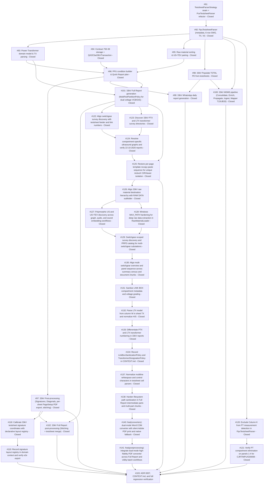

# 33kV System Workflow Expansion Index Map

> [!IMPORTANT]
> **Branching & QA Merge Policy**:
> - **Worktree & Feature Branch**: All implementation work across all tickets must be performed in the dedicated worktree `pahang-cli-33kv` on branch `feature/33kv-system` (branched from `main`).
> - **Active Project Directory**: `C:\Users\ADAM\Documents\PO 42394550 - PAHANG - 33kV - THUNDER` (Contract PO 42394550 - THUNDER).
> - **Isolation Invariant**: Under no circumstances should implementation commits be pushed directly to `main`.
> - **Merge Gate**: Merging `feature/33kv-system` back into `main` requires:
>   1. 100% green automated test suite (`pytest`) across all unit, adapter, workflow, and regression test suites.
>   2. Complete manual verification and CLI dry-run inspection approved by the human maintainer.
>   3. End-to-end dry run across all 14 workflows on real 33kV project data (THUNDER).

---

## Destination

Deliver an end-to-end, voltage-aware expansion across the Pahang CLI supporting 33kV sub-transmission and distribution projects (Contract PO 42394550 - THUNDER). Establishes a unified, voltage-polymorphic architecture across **all 14 actions** in the Project Workflow menu:
1. `Generate TESTSHEET Folder Structure`
2. `Populate TOTAL PE (from testsheets)` (syncing 33kV metadata into `TOTAL PE.xlsx` `DataCycle1`)
3. `Automate Raw Material Creation & Sorting (from Testsheets)` (PPU/PMU/SSU directory discovery, photo ranges, US+TEV multi-board discovery)
4. `Update QR02 CBA (from testsheets)` (`Qr02Cba33kVTransaction` for statewide contract 750-39 Columns G–R)
5. `Generate Quick Report` (`PpuSubstationConditionPairBuilderPolicy`, multi-voltage CBM defects, VI defect findings)
6. `Run Full Substation Post-Processing Pipeline (1-Click)` (signatures, diagonal borders, per-sheet PageSetup landscape/portrait PDF export, deliverable stitching `<STEM>.pdf`)
7. `Generate WhatsApp Report` (daily report rendering from 33kV Quick Reports and `TOTAL PE.xlsx`)
8. `Consolidate MSMS (PYTHON/MSMS/*.xls -> DATA MSMS)` (Maximo work order consolidation)
9. `Enrich MSMS (TOTAL PE -> DATA MSMS metadata)` (metadata enrichment)
10. `Propagate Work Orders (DATA MSMS -> TOTAL PE)` (WONUM propagation to `TOTAL PE.xlsx`)
11. `Ingest MSMS CSVs (RAW DATA -> TO BE FILLED)` (`T1SUB33` Maximo CSV ingestion)
12. `Populate Data MSMS (Testsheets -> TO BE FILLED CSVs)` (33kV `TestsheetReadingMapper` for online assessment meters)
13. `Generate Full Reports` (`MultiPartPartitionPolicy` for dual-voltage VCB/GIS cubicles and Power Transformers)
14. `Post-Process Full Reports (PDF + Testsheet Merge)` (multi-part batch PDF conversion, sequential stitching, testsheet merge into `<STEM>.pdf`)

Guarantees 100% backward compatibility and zero regressions across existing 11kV projects.

---

## Specification Reference

The authoritative specification for this effort is documented in [spec.md](./spec.md). It establishes the formal problem statement, user stories, core architectural decisions, testing seams, and out-of-scope boundaries. All tickets in this map implement vertical slices of this specification.

---

## Notes

- **Domain Model**: `TestsheetParserStrategy`, `PpuTestsheetParser`, `PceTestsheetParser`, `PowerTransformerSpec`, `SecondaryCompartmentRemarksPolicy`, `Qr02Cba33kVTransaction`, `PpuSubstationConditionPairBuilderPolicy`, `HighFidelityDocumentExportPolicy`, `ProjectEnvironment`, `MultiPartPartitionPolicy`.
- **Relevant Skills**: `tdd`, `codebase-design`, `caveman-commit`, `unslop`, `domain-modeling`.
- **Operating Invariant**: Existing 11kV testsheet formats (`PCE Testsheet`, `PCE VI`), contract 750-36 master workbooks, 11kV MSMS mappers, and 11kV Quick/Full Report templates must remain 100% functional without behavior alterations.
- **Shared Test Fixture Factory**: A shared PPU workbook fixture factory (`tests/fixtures/ppu_workbook_factory.py`) must be created to generate canonical 33kV workbooks with configurable panel counts, transformer ratings, and VI findings — reusable across all 33kV test files.
- **Naming Convention**: Only the newer 33kV sheet naming convention is targeted (`33kV (Main)`, `11kV (Main)`, `TX`, `Visual Inspec.` / `Visual Inspection`). The older `PMU-PPU-SSU Test Sheet (Main)` / `33kV (1)` convention from early fieldwork is superseded and out of scope.

---

## Work Breakdown & Phasing

---

## Tickets

### #91: feat(33kv-testsheet): TestsheetParserStrategy seam and PceTestsheetParser refactor
- **Status**: Closed
- **GitHub Issue**: [#91](https://github.com/adamlarGit/pahang-cli/issues/91)
- **Blocked by**: None (can start immediately)
- **Ticket File**: [tickets/091-testsheet-parser-strategy-seam.md](./tickets/091-testsheet-parser-strategy-seam.md)
- **Delivers**: Abstract `TestsheetParserStrategy` interface, refactored `PceTestsheetParser` wrapping all existing 11kV parsing logic with 100% backward compatibility, and voltage-routed parser factory.

### #92: feat(33kv-testsheet): PpuTestsheetParser for 33kV/11kV multi-sheet workbooks
- **Status**: Closed
- **GitHub Issue**: [#92](https://github.com/adamlarGit/pahang-cli/issues/92)
- **Blocked by**: #91
- **Ticket File**: [tickets/092-ppu-testsheet-parser.md](./tickets/092-ppu-testsheet-parser.md)
- **Delivers**: `PpuTestsheetParser` for 33kV workbooks parsing metadata (substation name, FL, date, type), dual-voltage switchgear lineups (6 physical sub-rows + Column Q SP: secondary panel), `Visual Inspec.` findings, RHS/LHS overview bays, `RAW DATA` photo bounds, and shared PPU workbook test fixture factory.

### #93: feat(33kv-domain): Power Transformer domain model and TX sheet parser
- **Status**: Closed
- **GitHub Issue**: [#93](https://github.com/adamlarGit/pahang-cli/issues/93)
- **Blocked by**: #92
- **Ticket File**: [tickets/093-secondary-panel-and-transformer-models.md](./tickets/093-secondary-panel-and-transformer-models.md)
- **Delivers**: `PowerTransformerSpec` model for $\ge 5$ MVA units with auxiliary thermals (`Marshalling Kiosk`, `Conservator Tank`, `Body`, `Cooling Fin`), TX sheet parser in `PpuTestsheetParser`, and transformer classification with warning on out-of-range ratings.

### #94: feat(33kv-master): Contract 750-39 storage resolution and Qr02Cba33kVTransaction
- **Status**: Closed
- **GitHub Issue**: [#94](https://github.com/adamlarGit/pahang-cli/issues/94)
- **Blocked by**: None (can start immediately, independent of #91/#92)
- **Ticket File**: [tickets/094-master-engr-750-39-and-qr02-transaction.md](./tickets/094-master-engr-750-39-and-qr02-transaction.md)
- **Delivers**: Statewide `ENGR-750-39 -CBA-PAHANG - {YEAR}.xlsx` storage path resolution (exact year match first, glob fallback with `ValueError` on ambiguity), `Qr02Cba33kVTransaction` handling Columns G–R, and QR03 defect lookup verification.

### #95: feat(33kv-raw): Raw material directory discovery and US+TEV multi-board archive extraction
- **Status**: Closed
- **GitHub Issue**: [#95](https://github.com/adamlarGit/pahang-cli/issues/95)
- **Blocked by**: #92
- **Ticket File**: [tickets/095-raw-material-sorting-and-us-tev-pairing.md](./tickets/095-raw-material-sorting-and-us-tev-pairing.md)
- **Delivers**: Substation directory stem matching for PPU/PMU/SSU naming conventions (in `src/project/storage.py`), IR/DG photo range copying from 33kV `RAW DATA` sheet, and US+TEV archive discovery for multi-board cubicles.

### #96: feat(33kv-quick-report): PPU/SSU condition photo pairing and multi-voltage Quick Report plan
- **Status**: Closed
- **GitHub Issue**: [#96](https://github.com/adamlarGit/pahang-cli/issues/96)
- **Blocked by**: #93, #94, #95
- **Ticket File**: [tickets/096-ppu-condition-builder-and-quick-report-plan.md](./tickets/096-ppu-condition-builder-and-quick-report-plan.md)
- **Delivers**: `PpuSubstationConditionPairBuilderPolicy` in `src/quick_report/substation_condition.py` (33kV/11kV switchgear, transformers, cable cellars, control panels, NER), multi-voltage CBM defect detail page generation iterating `switchgears` (plural) for dual-voltage packages, and VI defect detail callouts.

### #97: feat(33kv-postprocessing): 33kV pre-flight validation, signature alignment, diagonal borders, per-sheet PageSetup PDF export & deliverable stitching
- **Status**: Closed
- **GitHub Issue**: [#97](https://github.com/adamlarGit/pahang-cli/issues/97)
- **Blocked by**: #96
- **Ticket File**: [tickets/097-postprocessing-validation-and-pdf-export.md](./tickets/097-postprocessing-validation-and-pdf-export.md)
- **Delivers**: 33kV pre-flight validation rules, 33kV signature image anchor coordinates for 3 sheet layouts (Switchgear/TX/VI), diagonal borders range enforcement in `diagonal_borders.py` (Switchgear Rows 15–62 Cols C–U, TX Rows 7–70 Cols C–AB, VI unslashed), programmatic per-sheet PageSetup in `ComDocumentConverter` (Landscape A4 1mm margins for Switchgear/TX; Portrait A4 standard margins for VI; RAW DATA excluded), and consolidated `<STEM>.pdf` deliverable compilation.

### #98: feat(33kv-total-pe): Populate TOTAL PE from 33kV testsheets
- **Status**: Closed
- **GitHub Issue**: [#98](https://github.com/adamlarGit/pahang-cli/issues/98)
- **Blocked by**: #92
- **Ticket File**: [tickets/098-33kv-populate-total-pe.md](./tickets/098-33kv-populate-total-pe.md)
- **Delivers**: Voltage-aware `LocalExcelTotalPeRepository` adapter supporting 33kV testsheet packages extracted via `PpuTestsheetParser`, populating `DataCycle1` (`PE NO`, `FL NUMBER`, `SUBSTATION NAME`, `DATE`, `TYPE`, `WO`) with master `QR02 CBA` enrichment (Cols H & I), 2-digit/FL lookup keys, and 100% 11kV row-update parity.

### #99: feat(33kv-whatsapp): 33kV WhatsApp Daily Report generation
- **Status**: Closed
- **GitHub Issue**: [#99](https://github.com/adamlarGit/pahang-cli/issues/99)
- **Blocked by**: #96, #98
- **Ticket File**: [tickets/099-33kv-whatsapp-report.md](./tickets/099-33kv-whatsapp-report.md)
- **Delivers**: Voltage-aware WhatsApp daily report pipeline consolidating Quick Reports across multiple station directories per date, matching `TOTAL PE.xlsx` (`DataCycle1`), programmatically setting URLs and activity headers, dynamic multi-station grouping, and rendering `{NN}. {DD-MM-YYYY}.docx` to `PYTHON/WHATSAPP/`.

### #100: feat(33kv-msms): 33kV MSMS pipeline and TestsheetReadingMapper for T1SUB33
- **Status**: Closed
- **GitHub Issue**: [#100](https://github.com/adamlarGit/pahang-cli/issues/100)
- **Blocked by**: #92, #98
- **Ticket File**: [tickets/100-33kv-msms-pipeline.md](./tickets/100-33kv-msms-pipeline.md)
- **Delivers**: 33kV Maximo job plan `T1SUB33` support across MSMS pipeline, polymorphic `TestsheetReadingMapper` strategy (`PpuReadingMapper` across `33kV (Main)`, `11kV (Main)`, `TX`, `Visual Inspec.`), `TNBLOCATION` parent token resolution, and 100% parity with upstream consolidation, enrichment, and propagation.

### #101: feat(33kv-full-report): 33kV Full Report multi-part chunk generation
- **Status**: Closed
- **GitHub Issue**: [#101](https://github.com/adamlarGit/pahang-cli/issues/101)
- **Blocked by**: #93, #96
- **Ticket File**: [tickets/101-33kv-full-report-multipart-generation.md](./tickets/101-33kv-full-report-multipart-generation.md)
- **Delivers**: Expansion of `MultiPartPartitionPolicy` for 33kV dual-voltage VCB/GIS cubicles and Power Transformers: Part 01 Summary (Front page, Executive Summary Census, Visual Defect Summary, Switchgear Overview), Parts 02..N+1 (per-panel bay chunks with inline CBM defect pages across all lineups), Part N+2 (TX HV/LV sides via `tx-hv-sides.docx`/`tx-lv-sides.docx`, auxiliary thermals via `tx-overview.docx`, balance of plant, condition pages, visual defects, sticker page).

### #102: feat(33kv-full-report-postprocessing): 33kV Full Report multi-part PDF batch conversion, stitching, and testsheet merge
- **Status**: Closed
- **GitHub Issue**: [#102](https://github.com/adamlarGit/pahang-cli/issues/102)
- **Blocked by**: #97, #101
- **Ticket File**: [tickets/102-33kv-full-report-postprocessing.md](./tickets/102-33kv-full-report-postprocessing.md)
- **Delivers**: `FullReportPostProcessingWorkflow` execution on 33kV multi-part document chunks: batch Word COM PDF conversion, sequential part concatenation, and appended signed testsheet PDF merge into canonical deliverable `<STEM>.pdf`.

### #103: docs(33kv): Record ADR 0007, update CONTEXT.md, and e2e regression verification across all 14 workflows
- **Status**: Settled
- **GitHub Issue**: [#103](https://github.com/adamlarGit/pahang-cli/issues/103)
- **Blocked by**: #97, #99, #100, #102
- **Ticket File**: [tickets/103-docs-adr-and-e2e-regression-verification.md](./tickets/103-docs-adr-and-e2e-regression-verification.md)
- **Delivers**: ADR 0007 documenting the unified voltage-polymorphic architecture across all 14 actions, `CONTEXT.md` ubiquitous language additions, and complete regression test run verifying 0 failures across 11kV and 33kV test suites.

### #106: feat(msms): multi-tier substation matching and locked-file detection in Propagate Work Orders workflow
- **Status**: Closed
- **GitHub Issue**: [#106](https://github.com/adamlarGit/pahang-cli/issues/106)
- **Blocked by**: None
- **Ticket File**: [tickets/106-msms-multi-tier-matching.md](./tickets/106-msms-multi-tier-matching.md)
- **Delivers**: Multi-tier matching in PropagateWoFilter (FL -> Substation Name -> station token/date), locked-file preflight check on TOTAL PE.xlsx, and 100% (25/25) work order match rate on 33kV Thunder Cycle 4 dataset.

### #107: feat(msms): substation name matching and SAP FL synchronization in Enrich MSMS workflow
- **Status**: Closed
- **GitHub Issue**: [#107](https://github.com/adamlarGit/pahang-cli/issues/107)
- **Blocked by**: #106
- **Ticket File**: [tickets/107-enrich-msms-substation-name-matching.md](./tickets/107-enrich-msms-substation-name-matching.md)
- **Delivers**: Substation Name and station token fallback matching in EnrichMsmsFilter, SAP FL synchronization into Column E of DATA MSMS.xlsx, metadata enrichment into Columns D, F, G, and open/locked workbook preflight protection.

### #108: test(msms): end-to-end integration test and verification for 33kV workflows 8 through 12
- **Status**: Closed
- **GitHub Issue**: [#108](https://github.com/adamlarGit/pahang-cli/issues/108)
- **Blocked by**: #106, #107
- **Ticket File**: [tickets/108-msms-33kv-e2e-integration-tests.md](./tickets/108-msms-33kv-e2e-integration-tests.md)
- **Delivers**: Comprehensive end-to-end integration test suite exercising the complete 33kV MSMS pipeline (Workflows 8 through 12) across synthetic and active project environments with zero regressions.

### #118: fix(signatures): calibrate 33kV testsheet signature coordinates with declarative layout registry
- **Status**: Closed
- **GitHub Issue**: [#118](https://github.com/adamlarGit/pahang-cli/issues/118)
- **Blocked by**: None
- **Ticket File**: [tickets/118-calibrate-33kv-signature-coordinates.md](./tickets/118-calibrate-33kv-signature-coordinates.md)
- **Delivers**: Declarative signature layout registry mapping 33kV sheets (Switchgear, Transformer, Visual Inspection) to calibrated TwoCellAnchor coordinates with EMU offsets, template fix merging E77:F77 on sheet 33kV (Extra) (2), and updated assertions preserving 11kV signature placement.

### #119: docs(signatures): record signature layout registry in domain context and verify e2e export
- **Status**: Open
- **GitHub Issue**: [#119](https://github.com/adamlarGit/pahang-cli/issues/119)
- **Blocked by**: #118
- **Ticket File**: [tickets/119-docs-and-e2e-verification.md](./tickets/119-docs-and-e2e-verification.md)
- **Delivers**: Documenting signature coordinate layout registry in CONTEXT.md and ADR, end-to-end PDF export verification on real 33kV testsheet workbooks, and full regression test suite verification.

### #120: fix(testsheet): exclude compartment label Column K from PT measurement detection in PpuTestsheetParser
- **Status**: Closed
- **GitHub Issue**: [#120](https://github.com/adamlarGit/pahang-cli/issues/120)
- **Blocked by**: None (can start immediately)
- **Ticket File**: [tickets/120-exclude-compartment-label-from-pt-detection.md](./tickets/120-exclude-compartment-label-from-pt-detection.md)
- **Delivers**: Exclude pre-printed Column K compartment label from PT measurement detection in PpuTestsheetParser, check measurement columns ("L", "M", "N", "O", "R", "S", "T", "U", "V"), update test workbook factory, and add regression unit tests.

### #121: fix(full-report): verify PT compartment elimination on panels 1-4 for CJRT/MPU/G00008
- **Status**: Closed
- **GitHub Issue**: [#121](https://github.com/adamlarGit/pahang-cli/issues/121)
- **Blocked by**: #120
- **Ticket File**: [tickets/121-verify-pt-compartment-elimination-kuala-tahan.md](./tickets/121-verify-pt-compartment-elimination-kuala-tahan.md)
- **Delivers**: Regenerate and verify Full Report deliverable package for CJRT/MPU/G00008 (MINI PPU KUALA TAHAN 33/11kV), ensuring PT COMPARTMENT is generated strictly for Panel 5 (PANEL 31 - TX 5MVA) and eliminated from Panels 1 to 4.

### #122: fix(prpd): align switchgear survey discovery with testsheet feeder and link numbers
- **Status**: Closed
- **GitHub Issue**: [#122](https://github.com/adamlarGit/pahang-cli/issues/122)
- **Blocked by**: #101
- **Ticket File**: [tickets/122-align-switchgear-survey-discovery-with-testsheet-feeder-numbers.md](./tickets/122-align-switchgear-survey-discovery-with-testsheet-feeder-numbers.md)
- **Delivers**: Align switchgear survey discovery in `_discover_substation_assets` and `find_swg_feeder_survey_dir` to match testsheet feeder numbers and names.

### #123: feat(prpd): discover 33kV PTX and LTX transformer survey directories
- **Status**: Closed
- **GitHub Issue**: [#123](https://github.com/adamlarGit/pahang-cli/issues/123)
- **Blocked by**: #101
- **Ticket File**: [tickets/123-discover-33kv-ptx-and-ltx-transformer-survey-directories.md](./tickets/123-discover-33kv-ptx-and-ltx-transformer-survey-directories.md)
- **Delivers**: Transformer survey directory discovery recognizing 33kV `PTX` and `LTX` directories and mapping them to transformer specs.

### #124: fix(full-report): resolve compartment-specific ultrasound graphs and verify 22-10-2026 reports
- **Status**: Closed
- **GitHub Issue**: [#124](https://github.com/adamlarGit/pahang-cli/issues/124)
- **Blocked by**: #122, #123
- **Ticket File**: [tickets/124-resolve-compartment-specific-ultrasound-graphs-and-verify-22-10-2026.md](./tickets/124-resolve-compartment-specific-ultrasound-graphs-and-verify-22-10-2026.md)
- **Delivers**: Resolve compartment-specific ultrasound graphs (Breaker, Cable, Busbar) without duplicating single panel-wide graphs on 22-10-2026 reports.
- [x] `SwitchgearScanAdapter` resolves compartment-specific ultrasound graphs for Circuit Breaker, Cable Box, and Upper Busbars.
- [x] Full Reports generated for `22-10-2026` under `FULL REPORT/JERANTUT/01. OCTOBER/22-10-2026/` have populated, correctly attributed US graphs in all panel and transformer scanning documents (Part 02 through Part 07).
- [x] No regression on previously working substations (e.g. `25. MINI PPU SG KOYAN`).
- [x] Automated end-to-end verification tests pass.

### #125: fix(compiler): restore per-page template recopy-paste sequence for unique ActiveX CIRViewer isolation (#ADR-0002)
- **Status**: Closed
- **GitHub Issue**: [#125](https://github.com/adamlarGit/pahang-cli/issues/125)
- **Blocked by**: None
- **Ticket File**: [tickets/125-restore-per-page-template-recopy-paste-sequence.md](./tickets/125-restore-per-page-template-recopy-paste-sequence.md)
- **Delivers**: Restore the standard Word COM per-page copy-and-paste ingestion lifecycle in `src/quick_report/compiler.py` and Full Report assembly to ensure Microsoft Word's native ActiveX container engine assigns unique incremental identifiers to embedded FLIR `CIRViewer` controls without image crosstalk.
- [x] Align the Word COM copy-paste ingestion sequence in `src/quick_report/compiler.py` and `src/full_report/` with the standard manual process (individual copy from source/template, paste into destination document) so Word's native OLE container assigns unique counters.
- [x] All pages containing the FLIR IR plugin across multi-part Full Reports (e.g. Parts 01 through 06 in `FULL REPORT/JERANTUT/01. OCTOBER/22-10-2026`) have isolated ActiveX controls.
- [x] Modifying an IR thermal image or parameters on the first page in Microsoft Word does not modify or link to subsequent pages.
- [x] Verify fix against `MINI PPU KUALA TAHAN 33/11kV` and `MINI PPU MERTING 33/11kV` deliverables and automated tests.

### #126: fix(storage): align 33kV raw material destination hierarchy with RAW DATA subfolder
- **Status**: Closed
- **GitHub Issue**: [#126](https://github.com/adamlarGit/pahang-cli/issues/126)
- **Blocked by**: #125
- **Ticket File**: [tickets/126-align-33kv-raw-material-hierarchy.md](./tickets/126-align-33kv-raw-material-hierarchy.md)
- **Delivers**: Align 33kV raw material destination hierarchy in `RawMaterialTransformer` by appending `RAW DATA/` to match 11kV directory hierarchy parity, defaulting new 33kV surveys to `RAW DATA/US/`, and migrating legacy loose folders into `RAW DATA/` in `RawMaterialLoader`.

### #127: feat(survey): Polymorphic US and US+TEV discovery across graph, audio, and sound embedding workflows
- **Status**: Closed
- **GitHub Issue**: [#127](https://github.com/adamlarGit/pahang-cli/issues/127)
- **Blocked by**: #126
- **Ticket File**: [tickets/127-polymorphic-us-and-us-tev-discovery.md](./tickets/127-polymorphic-us-and-us-tev-discovery.md)
- **Delivers**: Polymorphic `US` and `US+TEV` structure discovery across PRPD graph discovery, standalone US+TEV graph generation, and audio extraction workflows with centralized `resolve_survey_container_dir()` helper.

### #128: fix(storage): Windows MAX_PATH hardening for deep raw data extraction in RawMaterialLoader
- **Status**: Closed
- **GitHub Issue**: [#128](https://github.com/adamlarGit/pahang-cli/issues/128)
- **Blocked by**: #126
- **Ticket File**: [tickets/128-windows-max-path-hardening.md](./tickets/128-windows-max-path-hardening.md)
- **Delivers**: Extended path `\\?\` prefixing via `safe_path()` in `src.core.path_utils`, hardened `LocalWorkspaceStorage.ensure_directory`, and applied throughout `RawMaterialLoader` with COM workflows strictly untouched.

### #129: feat(survey): switchgear-scoped UltraTEV survey discovery and PRPD catalog for multi-switchgear substations
- **Status**: Closed
- **GitHub Issue**: [#129](https://github.com/adamlarGit/pahang-cli/issues/129)
- **Blocked by**: #127, #128
- **Ticket File**: [tickets/129-switchgear-scoped-survey-prpd-catalog.md](./tickets/129-switchgear-scoped-survey-prpd-catalog.md)
- **Delivers**: Enable accurate, collision-free US and TEV PRPD graph generation and attachment for substations with multiple switchgear lineups (e.g. 33kV GIS and 11kV VCB sharing panel indices 1..8) with switchgear-scoped feeder discovery, catalog indexing (`catalog["swg"][swg_idx][panel_no]`), isolated graph filenames (`prpd_swg{swg_idx}_panel{panel_no}_...`), and adapter waveform resolution.
- [x] `_discover_substation_assets` discovers feeders scoped to each switchgear lineup without overwriting shared panel numbers.
- [x] `catalog["swg"]` indexes graphs per switchgear lineup (`swg_index`).
- [x] Generated PRPD image filenames include switchgear index (`prpd_swg{swg_idx}_panel{panel_no}_...`).
- [x] `SwitchgearScanAdapter._resolve_prpd` correctly pulls waveforms for both 33kV and 11kV panels without cross-lineup graph contamination.
- [x] Passes all test suites in `tests/test_prpd_generator.py` and `tests/test_full_report_scan_adapters.py`.

### #130: feat(full-report): align multi-switchgear overview and panel sequence across summary census and document chunks
- **Status**: Closed
- **GitHub Issue**: [#130](https://github.com/adamlarGit/pahang-cli/issues/130)
- **Blocked by**: #129
- **Ticket File**: [tickets/130-align-multiswitchgear-overview-and-panel-sequence.md](./tickets/130-align-multiswitchgear-overview-and-panel-sequence.md)
- **Delivers**: Implement strict multi-switchgear generation sequence prioritizing 33kV before 11kV, with separate overview documents per switchgear lineup (Option A): Part 01 Summary, Part 02 Switchgear 1 (33kV) Overview, 33kV Panels, Switchgear 2 (11kV) Overview, 11kV Panels, and Transformers/Condition, with aligned executive summary census ordering.
- [x] Multi-part partitioning produces dedicated overview chunks per switchgear lineup: Part 01 Summary, 33kV Overview, 33kV Panels, 11kV Overview, 11kV Panels, and TX/Condition.
- [x] Census summary tables order 33kV lineup before 11kV lineup.
- [x] Document chunk indices and labels reflect Option A structure cleanly.
- [x] All unit and plan builder tests in `tests/test_full_report_workflow.py` pass.

### #131: feat(full-report): sanitize LINK BOX compartment metadata and voltage grading
- **Status**: Closed
- **GitHub Issue**: [#131](https://github.com/adamlarGit/pahang-cli/issues/131)
- **Blocked by**: #130
- **Ticket File**: [tickets/131-sanitize-link-box-compartment-metadata.md](./tickets/131-sanitize-link-box-compartment-metadata.md)
- **Delivers**: Sanitize LINK BOX scan page metadata in `SwitchgearScanAdapter.adapt()` (`swg.type='LINK BOX'`, `swg.manufacturer='-'`, `swg.model='-'`, `swg.rating='33kV'/'11kV'`, `panel.area='-'`, `panel.serialnumber='-'`, `panel.serial_no='-'`, `panel.heateramp='-'`, `panel.breakerstatus='-'`, `panel.busbarposition='-'`, `panel.cabletype='-'`), preserving parent panel feeder/name/load/IR readings while ensuring US/TEV blocks remain blanked.
- [x] Override `swg` and `panel` context fields when `comp_name == 'LINK BOX'` in `SwitchgearScanAdapter.adapt()`.
- [x] Preserve parent panel link number, name, load, and thermals.
- [x] Ensure ultrasound and TEV cells continue to be blanked.
- [x] Unit tests for 33kV and 11kV Link Box context generation in `tests/test_full_report_scan_adapters.py`.

### #132: fix(testsheet): parse LTX model from column W in sheet TX and normalize H/S
- **Status**: Closed
- **GitHub Issue**: [#132](https://github.com/adamlarGit/pahang-cli/issues/132)
- **Blocked by**: #131
- **Ticket File**: [tickets/132-parse-ltx-model-from-column-w.md](./tickets/132-parse-ltx-model-from-column-w.md)
- **Delivers**: Slot 5 column definition extended to include column W (`'T', 'U', 'V', 'W'`) in `PpuTestsheetParser._extract_tx_sheet()`, parsing LTX model from cell W6 when V6 is `MODEL:`, and normalizing model abbreviation `H/S` to `HERMETICALLY SEAL` (and `C/T` to `CONSERVATOR TANK`) in `TransformerSpec`.
- [x] In `src/testsheet/parsers/ppu.py`, Slot 5 column definition is updated to include column `W` (e.g. `cols: ('T', 'U', 'V', 'W')`).
- [x] `_get_tx_model()` successfully extracts values located in cell `W6` when `V6` is `MODEL:`.
- [x] `TransformerSpec.model` is populated with `HERMETICALLY SEAL` when `W6` has `H/S` (or `CONSERVATOR TANK` when `W6` has `C/T`).
- [x] Unit tests verify extraction of Slot 5 local transformer model across candidate testsheets.

### #133: feat(full-report): differentiate PTX and LTX transformer numbering in 33kV reports
- **Status**: Closed
- **GitHub Issue**: [#133](https://github.com/adamlarGit/pahang-cli/issues/133)
- **Blocked by**: #132
- **Ticket File**: [tickets/133-differentiate-ptx-and-ltx-transformer-numbering.md](./tickets/133-differentiate-ptx-and-ltx-transformer-numbering.md)
- **Delivers**: Transformer identifier differentiation by asset archetype (`PTX1`..`PTX4` for `PowerTransformerSpec` >= 5 MVA from Slots 1-4, `LTX` for local station service transformers from Slot 5 or with LOCAL in ID, and `TX1`..`TX2` for standard distribution transformers), applying to `Tx No.` cell, scan render item titles (`PTX1 - <COMP>`, `LTX - <COMP>`), CBM defect page headers and defect forwarding banners, while preserving Table 26 placards (`POWER TX1`, `POWER TX2`, `LOCAL TX`) and verbatim visual defect descriptions.
- [x] `normalize_tx_id()` in `src/core/normalizers.py` or `TransformerScanAdapter` correctly resolves `PTX{n}` for `PowerTransformerSpec` and `LTX` for local station service transformers.
- [x] Transformer scan pages render `PTX1`, `PTX2`, and `LTX` in the `Tx No.` cell.
- [x] Component scan page item titles use `PTX1 - <COMPONENT>` and `LTX - <COMPONENT>`.
- [x] Standard distribution transformers continue to resolve to `TX1`, `TX2`.
- [x] Condition overview placards in Table 26 remain `POWER TX1`, `POWER TX2`, and `LOCAL TX`.
- [x] Visual inspection defect descriptions are unmodified.
- [x] Unit and regression tests verify transformer numbering across PMU/PPU and standard distribution packages.

### #134: docs(domain): record LinkBoxSanitizationPolicy and TransformerDesignationPolicy in CONTEXT.md
- **Status**: Closed
- **GitHub Issue**: [#134](https://github.com/adamlarGit/pahang-cli/issues/134)
- **Blocked by**: #133
- **Ticket File**: [tickets/134-record-domain-policies-in-context.md](./tickets/134-record-domain-policies-in-context.md)
- **Delivers**: Formal domain entries in `CONTEXT.md` for `LinkBoxSanitizationPolicy` (field overrides, parent panel attribute preservation, US/TEV blanking) and `TransformerDesignationPolicy` (`PTX{n}`, `LTX`, `TX{n}` hierarchy, Slot 1–5 coordinates, Column W model origin, shorthand expansion, and report propagation).
- [x] `CONTEXT.md` contains formal entries for `LinkBoxSanitizationPolicy` and `TransformerDesignationPolicy`.
- [x] All field mappings and rules match the agreed domain contracts.
- [x] No regression or contradiction with existing ADRs or glossary definitions.

### #137: fix(testsheet): normalize multiline whitespace and control characters in testsheet cell parsers
- **Status**: Closed
- **GitHub Issue**: [#137](https://github.com/adamlarGit/pahang-cli/issues/137)
- **Blocked by**: None
- **Ticket File**: [tickets/137-normalize-multiline-whitespace-in-testsheet-parsers.md](./tickets/137-normalize-multiline-whitespace-in-testsheet-parsers.md)
- **Delivers**: Normalization of multiline strings, carriage returns, newlines, and tabs (\r\n, \n, \r, \t) into single spaces across `clean_val` and all testsheet parsers (switchgear panels, feeder names, header metadata, transformers).
- [x] Cell string cleaner collapses internal carriage returns, newlines, and tabs (\r\n, \n, \r, \t) into a single space and strips outer padding.
- [x] Switchgear panel names, feeder names, and header metadata parsed from testsheets with multiline cell entries produce clean single-line strings.
- [x] Unit tests verify multiline string normalization across clean_val and switchgear panel extraction without regressions on existing single-line, numeric, or empty cells.

### #138: fix(full-report): harden filesystem path sanitization in full report intermediate parts and multi-part chunks
- **Status**: Closed
- **GitHub Issue**: [#138](https://github.com/adamlarGit/pahang-cli/issues/138)
- **Blocked by**: None
- **Ticket File**: [tickets/138-harden-filesystem-path-sanitization-in-full-report.md](./tickets/138-harden-filesystem-path-sanitization-in-full-report.md)
- **Delivers**: Comprehensive sanitization of Windows-forbidden characters and ASCII control characters ([\x00-\x1f\r\n\t]) across `sanitize_filename`, `render_all()` intermediate docx part generation, and `MultiPartPartitionPolicy` / `PlanDocumentChunk` document compilation, preventing `[Errno 22] Invalid argument` on substations with complex or multiline panel names (e.g. SSU LYNAS 33kV).
- [x] Intermediate scan part filename generation in plan_builder.py:render_all sanitizes all forbidden Windows characters and control characters ([\x00-\x1f\r\n\t]).
- [x] Shared sanitize_filename utility strips/replaces ASCII control characters ([\x00-\x1f\r\n\t]) in addition to existing reserved characters ([<>:"/\\|?*]).
- [x] Multi-part partition chunk labels and output filenames are sanitized against control characters and invalid filename characters.
- [x] Regression test verifies that Full Report generation compiles all intermediate parts and multi-part chunk deliverables for SSU LYNAS 33kV without [Errno 22] Invalid argument or COM compilation failures.

### #140: feat(converters): dual-mode Word COM converter with silent Adobe PDF print and native fallback
- **Status**: Closed
- **GitHub Issue**: [#140](https://github.com/adamlarGit/pahang-cli/issues/140)
- **Blocked by**: None
- **Ticket File**: [tickets/140-dual-mode-word-com-converter.md](./tickets/140-dual-mode-word-com-converter.md)
- **Delivers**: Silent high-fidelity Word-to-PDF conversion via Adobe PDF printer with transient PrinterJobControl registry automation and fallback to ExportAsFixedFormat.
- [x] ComDocumentConverter.convert_docx_to_pdf checks for Adobe PDF printer and runs silent print with transient PrinterJobControl registry automation for both WINWORD.EXE and splwow64.exe.
- [x] Active Acrobat Distiller joboptions preset High Quality Print(1) or equivalent non-downsampling profile is utilized.
- [x] Registry entries in HKCU\Software\Adobe\Acrobat Distiller\PrinterJobControl are cleaned up deterministically in a finally block even if errors occur.
- [x] Graceful fallback to doc.ExportAsFixedFormat occurs if Adobe PDF is missing or on error.
- [x] Unit tests in tests/test_postprocessing_cli_adapter.py / tests/test_converters.py verify both the Adobe PDF branch and fallback branch.

### #141: feat(postprocessing): integrate dual-mode high-fidelity PDF converter across Full Report and Utility batch workflows
- **Status**: Open
- **GitHub Issue**: [#141](https://github.com/adamlarGit/pahang-cli/issues/141)
- **Blocked by**: #140
- **Ticket File**: [tickets/141-integrate-dual-mode-pdf-converter.md](./tickets/141-integrate-dual-mode-pdf-converter.md)
- **Delivers**: Integration and end-to-end verification of dual-mode high-fidelity Word converter across Full Report postprocessing, batch docx_to_pdf, and full substation pipeline.
- [ ] src/workflows/full_report_postprocessing.py utilizes dual-mode converter with testsheet appending and ultrasound embedding.
- [ ] src/workflows/docx_to_pdf.py utilizes dual-mode high-fidelity conversion.
- [ ] src/workflows/postprocessing_pipeline.py integrates dual-mode high-fidelity conversion.
- [ ] Unit and workflow test suite passes with zero regressions.

---

## Decisions so far

- **Q1**: File path correction — condition builder work targets `src/quick_report/substation_condition.py`, not the non-existent `condition_builder.py`.
- **Q2**: Initial parser ticket split into #91 (strategy seam + PceTestsheetParser refactor) and #92 (PpuTestsheetParser implementation).
- **Q3**: Transformer ratings limited to 100 kVA–1000 kVA (local/distribution) and 5–15 MVA (power). No gap to fill.
- **Q4**: TestsheetReadingMapper and MSMS 33kV workflow brought into full scope (Ticket #100) using Maximo job plan `T1SUB33`.
- **Q5**: Visual Inspection sheet parsing explicitly assigned to ticket #92.
- **Q6**: Ticket #94 is independently startable — no dependency on #91/#92. Edge `T91/T92→T94` removed.
- **Q7**: 750-39 workbook resolution: exact year match first, glob fallback, `ValueError` on ambiguous matches.
- **Q8**: 33kV projects use same `TESTSHEET/` directory convention. Double-digit numbering (vs triple-digit for 11kV) already handled by existing `extract_numerical_prefix` regex.
- **Q9**: Revised dependency graph confirmed after split and #94 independence.
- **Q10**: Ticket #95 targets `src/project/storage.py` for stem parsing, not the non-existent `src/testsheet/discovery.py`.
- **Q11**: Double-digit substation numbering requires no code changes — `r'^(\d+)'` regex handles both formats.
- **Q12**: VI parsing assigned to ticket #92 (keep all `PpuTestsheetParser` sheet parsing in one place).
- **Q13**: Ticket #97 must include explicit voltage-aware `select_and_sort_sheets()` rewrite.
- **Q14**: Out-of-range transformer ratings: log warning and default to `TransformerSpec`. No pipeline crash.
- **Q15**: MSMS 33kV reading mapping graduated from fog of war into formal Ticket #100.
- **Q16**: 33kV sheets need image-based signature insertion with corrected alignment. 3 distinct anchor layouts discovered.
- **Q17**: Downstream consumers must iterate `switchgears` (plural) for dual-voltage packages. Covered in #96.
- **Q18**: Shared PPU workbook test fixture factory to be created in `tests/fixtures/ppu_workbook_factory.py`.
- **Q19–Q22**: Merge blocked until both Quick Report and Full Report implementations complete.
- **Q23**: Full Report tickets added as #101 and #102 implementing `MultiPartPartitionPolicy`.
- **Q24**: Full Report 33kV expansion covered in #101 and #102.
- **Q25**: Ticket #97 documents 3 signature anchor coordinate sets (Switchgear: `E77`/`L77`, TX: `F73`/`R73`, VI: `D82`/`M82`).
- **Q26**: Only newer 33kV naming convention targeted (`33kV (Main)`, `11kV (Main)`, `TX`, `Visual Inspec.` / `Visual Inspection`). Older convention superseded and out of scope.
- **Q27**: Full Report ticket drafting incorporates multi-part chunk partitioning for dual-voltage VCB/GIS.
- **Q28**: Merge gate expanded to require real-project end-to-end dry run on THUNDER.
- **Q29**: Unified 14-action Project Workflow menu across 11kV and 33kV with polymorphic runtime dispatch via `ProjectEnvironment.voltage_type`.
- **Q30**: 33kV `TOTAL PE.xlsx` exists in `PYTHON/TOTAL PE.xlsx` with `DataCycle1` tracking `PE NO`, `FL NUMBER`, `SUBSTATION NAME`, `DATE`, `TYPE`, and `WO`. Handled in #98.
- **Q31**: WhatsApp daily reporting active for 33kV, rendering from Quick Reports and `TOTAL PE.xlsx` into `PYTHON/WHATSAPP/`. Handled in #99.
- **Q32**: MSMS pipeline active for 33kV under Maximo job plan `T1SUB33` (`TIER 1-ONLINE CONDITION ASSESMENT`), using `DATA MSMS.xlsx`, work order XLS, and 33kV `TestsheetReadingMapper`. Handled in #100.
- **Q33**: Testsheet COM PDF export enforces per-sheet PageSetup: Landscape A4 with 1mm (`0.039"`) tight margins for Switchgear/TX sheets (fit 1 page wide); Portrait A4 with standard margins (`0.25"/0.75"`) for `Visual Inspec.`; `RAW DATA` strictly excluded. Handled in #97.
- **Q34**: Diagonal borders apply to Switchgear (Rows 15–62, Cols C–U) and TX (Rows 7–70, Cols C–AB); Visual Inspection is unslashed. Supported in both 1-Click Post-Processing and standalone utility. Handled in #97.
- **Q35**: Full Report follows 11kV `MultiPartPartitionPolicy` for VCB/GIS cubicles (Part 01 Summary, Bay Chunks, TX & Condition Chunk); manual reports in `FULL REPORT/` act as content/styling reference. Handled in #101 and #102.
- **Q36**: Merge gate requires 100% green tests and end-to-end dry run on THUNDER across all 14 actions.
- **Q37**: 33kV active project path confirmed as `C:\Users\ADAM\Documents\PO 42394550 - PAHANG - 33kV - THUNDER`.
- **Q38**: Substation stem parsing formalized via `SubstationStemInfo` and `parse_substation_stem()` in `src/project/storage.py`; `get_substation_raw_data_dir()` matches directory numeric prefixes via `extract_numerical_prefix()`.
- **Q39**: 33kV destination folder in `RawMaterialTransformer` resolves to existing matching directory or testsheet stem (e.g. `01. PPU APMM 33-11kV (VI)`); preserves `f"{num:03d}"` for 11kV.
- **Q40**: Dual `US` and `US+TEV` discovery supported in `UNSORTED RAW DATA`; canonical destination is `US+TEV` (reusing `US` if already present).
- **Q41**: `UsTevCardinalityPolicy` adapted for 33kV to support multi-board archives (1-to-many into `<US_DEST>/<ZIP_STEM>/`); strict 1-to-1 preserved for 11kV.
- **Q42**: Photo range bounds strictly ingested from `RAW DATA` sheet via `PpuTestsheetParser`; no heuristic guessing from panel photo columns if left unpopulated.
- **Q43**: `UsTevArchiveMatching` supports 2-digit zero-padded tokens (`f"{num:02d}"`) and station name token disambiguation.
- **Q44**: `PpuSubstationConditionPairBuilderPolicy` generates condition photo pairs matching 33kV on-site layout (Page 1: Overview/Signboard, SWG 33kV/11kV; Page 2: Power TX1/2, Local TX; Page 3: Feeder Pillar/LVDB, Control Panel 33kV/11kV, Fire Extinguisher; Page 4: NER, Cable Cellars) with dynamic omission of absent assets. Handled in #96.
- **Q45**: Quick Report VI defects strictly fetched from master ENGR workbook (`QR03 VI`); no automatic fallback to testsheet checklist items. Handled in #96.
- **Q46**: Quick Report planning and rendering modules strictly iterate `equipment.switchgears` (plural), attributing defects across both lineups and displaying appropriate voltage classes (`GIS 33kV` vs `VCB 11kV`). Handled in #96.
- **Q47**: Quick Report output filenames format 2-digit zero-padding `f"{pe_number:02d}."` for 33kV, retaining 3-digit for 11kV. Handled in #96.
- **Q48**: Condition photo pairs label transformers $\ge 5$ MVA as `POWER TX1` / `POWER TX2` and auxiliary units as `LOCAL TX`. Handled in #96.
- **Q49**: Multi-page condition chunking (3 pairs per page) and oxml empty-cell border clearing reused directly for 1–4 page 33kV condition sets. Handled in #96.
- **Q50**: Pre-flight validation and file renaming match 33kV packages across Quick Reports, testsheets, and raw material folders by numerical prefix via `extract_numerical_prefix()`. Handled in #97.
- **Q51**: `select_and_sort_sheets()` sorts 33kV sheets in strict sequential order (`33kV (Main)` → sequential extra sheets → `11kV (Main)` → sequential extra sheets → `TX` → `Visual Inspec.`), strictly excluding `RAW DATA` and unpopulated extra template sheets. Handled in #97.
- **Q52**: `ComDocumentConverter` configures individual per-sheet margins and orientations (Landscape A4 1mm margins for Switchgear/TX; Portrait A4 0.25"/0.75" margins for VI; fit 1-page wide). Handled in #97.
- **Q53**: Signature insertion routes through 3 distinct layout anchor geometries (Switchgear `E77`/`L77`, TX `F73`/`R73`, VI `D82`/`M82`) with clean placeholder sanitization in `mode="none"`. Handled in #97.
- **Q54**: Diagonal borders apply to Switchgear `C15:U62` and 5 specific TX cell groups (`F14:AD28`, `F33:AD47`, `D51:F54`, `D57:O58`, `C62:Q71`), safely handling merged cells; VI sheet strictly unslashed. Handled in #97.
- **Q55**: Post-processing deliverable compilation reuses sequential PDF merge (`converter.merge_pdfs`) to stitch portrait Quick Report, landscape Switchgear/TX, and portrait VI into `<STEM>.pdf`. Handled in #97.
- **Q56**: For 33kV packages, `PopulateTotalPeWorkflow` looks up the testsheet Functional Location (`data.fl_erms`) against Column G of `QR02 CBA` in `ENGR-750-39 -CBA-PAHANG - {YEAR}.xlsx` to retrieve official `SUBSTATION NAME` from Column H (writing to `TOTAL PE.xlsx` Col C) and `TYPE` from Column I (writing to `TOTAL PE.xlsx` Col E). Handled in #98.
- **Q57**: If an FL is not found in `QR02 CBA`, the workflow logs a warning and gracefully falls back to cell `D6` on `33kV (Main)` for `substation_name` and the prefix/stem (`PPU`, `SSU`, `PMU`) for `substation_type`, allowing `TOTAL PE.xlsx` population to complete without errors. Handled in #98.
- **Q58**: 33kV maintains 100% parity with 11kV row-updating: `upsert_packages()` updates Columns A through F directly on matched rows without custom protection rules on Column F. Maximo work orders continue to be populated via Action 10 (`Propagate Work Orders`). Handled in #98.
- **Q59**: In `TOTAL PE.xlsx` (`DataCycle1`), writes are restricted to Columns A–F, and `_sort_datacycle_sheet()` carries all columns up to `max_column` while preserving any cell starting with `=` (formula cells). Handled in #98.
- **Q60**: Row lookup dictionary in `upsert_packages()` supports 2-digit zero-padded keys `(f"{pe_no:02d}", dt_str)` and Functional Location keys `(fl_num, dt_str)` in addition to standard keys. Handled in #98.
- **Q61**: Each subsystem honours its designated date format without divergence (e.g. `TOTAL PE.xlsx` uses native date with `DD-MMM-YYYY`, MSMS uses ISO `YYYY-MM-DD`, etc.). Handled in #98.
- **Q62**: In 33kV, WhatsApp report output filenames format strictly as `{next_num:02d}. {clean_date}.docx` (e.g. `01. 07-10-2026.docx`), omitting single station tokens to reflect multi-station daily coverage; preserving `{next_num:02d}. {station} {clean_date}.docx` for 11kV. Handled in #99.
- **Q63**: 33kV WhatsApp workflow consolidates Quick Reports matching the target date across all station folders under `QUICK REPORT/` (e.g. GEBENG and KUANTAN for 07-10-2026). Handled in #99.
- **Q64**: When multiple stations are inspected on the same day, the WhatsApp report header renders joined stations (`STATION : *GEBENG/KUANTAN*`) and the body groups items under bold station subheadings (`*GEBENG*`, `*KUANTAN*`) with continuous 1-based sequential numbering. When only one station is present, no subheadings are printed. Handled in #99.
- **Q65**: `QUALIFYING_DOCX_PATTERN` is updated to anchor defect indicators to the trailing parentheses (`r"^(\d+)\.?\s*(.*?)(?:\s*\(([^()]+)\))?\.docx$"`), preserving internal parenthesized tokens in substation names (e.g. `SSU KIIP (SSU CAMEL POWER)`). Handled in #99.
- **Q66**: WhatsApp template links (`link_laporan`, `link_engr`) and activity label (`activity`: `CBM 33KV` vs `CBM 11kV`) are set programmatically via template rendering context based on `ProjectEnvironment.voltage_type`, avoiding hardcoded URLs in `.docx` templates. Handled in #99.
- **Q67**: Trailing defect indicator extraction (`(VI)`, `(US+VI)`, `-`) and MSMS WONUM lookup from `TOTAL PE.xlsx` (`DataCycle1` Column F) maintain 100% parity with 11kV. Handled in #99.
- **Q68**: Maximo job plan `T1SUB33` is detected across MSMS CSV ingestion and reading population, routing through a dedicated 33kV reading mapper strategy. Handled in #100.
- **Q69**: `TestsheetReadingMapper` implements a polymorphic strategy seam (`ReadingMapperStrategy`, with `PceReadingMapper` for 11kV and `PpuReadingMapper` for 33kV) to resolve meter coordinates across `33kV (Main)`, `11kV (Main)`, `TX`, and `Visual Inspec.`. Handled in #100.
- **Q70**: In 33kV MSMS CSVs, characteristic meters (`VI_*`) already default to `"NO"`; `PopulateDataMsmsWorkflow` only updates rows to `"YES"` with comments when a defect is detected in `Visual Inspec.` or master `QR03`, leaving sound equipment untouched (100% parity with 11kV). Handled in #100.
- **Q71**: Upstream workflows `ConsolidateMsmsWorkflow`, `EnrichMsmsWorkflow`, and `PropagateWoAction` are reused 100% directly for 33kV without modifying table extraction or column structure. Handled in #100.
- **Q72**: `TNBLOCATION` bay-level paths (e.g. `CGBG/PPUAPMM/33KV/3P5`) are correlated with parent substation packages by trimming bay segments after `/33KV/`, `/11KV/`, or `/TX/`. Handled in #100.
- **Q73**: 33kV strictly adheres to the 3-stage directory lifecycle in `PYTHON/MSMS/` (`RAW DATA` -> `TO BE FILLED` -> `COMPLETED`). Handled in #100.
- **Q74**: `MultiPartPartitionPolicy` iterates all switchgear lineups in `package.switchgears` (plural), generating sequential bay chunks for both 33kV and 11kV lineups (e.g. `Part 02 - Panel 01 (33kV - 3P5)`, ..., `Part 11 - Panel 01 (11kV - 1K5)`), ensuring every cubicle across both voltage levels gets its own modular Word chunk. Handled in #101.
- **Q75**: Chunk N+2 (`Part {N+2:02d} - TX and Condition`) renders Power Transformers ($\ge 5$ MVA units) using `tx-overview.docx` as the template for auxiliary scans (`Marshalling Kiosk`, `Conservator Tank`, `Cooling Fin`) and dedicated templates for HV and LV sides (`tx-hv-sides.docx`, `tx-lv-sides.docx`), before appending the condition grid, visual defect details, and sticker page. Handled in #101.
- **Q76**: `MultiPartPartitionPolicy` dynamically omits empty chunks when assets are absent (e.g. skipping 11kV bay chunks if no 11kV lineup exists, and omitting Chunk N+2 if there are no transformers, condition photos, or visual defect pages). Handled in #101.
- **Q77**: Substation title transformation preserves standard 11kV behavior: only changing `QUICK SCANNING REPORT` to `FULL SCANNING REPORT` in the sliced front page without introducing custom 33kV voltage text transformations. Handled in #101.
- **Q78**: 33kV Full Report chunk filenames and consolidated deliverable PDF format the substation prefix with 2-digit zero-padding `f"{pe_number:02d}."` (e.g. `06. SSU FLEXSYS CHEMICAL 33kV (VI) - Part 01 - Summary.docx`), preserving 3-digit zero-padding for 11kV. Handled in #101.
- **Q79**: Intermediate Word chunk files (`Part 01 - Summary.docx`, bay chunks, `Part N+2 - TX and Condition.docx`) are permanently retained in the substation date directory per ADR 0005 to avoid FLIR Tools+ ActiveX memory exhaustion and allow operator inspection. Handled in #101.
- **Q80**: `_find_pdf_in_dirs()` Phase 2 prefix matching includes `f"{prefix_num:02d}."` alongside `f"{prefix_num:03d}."` and unpadded formats, ensuring 2-digit zero-padded testsheet PDFs (e.g. `06. SSU FLEXSYS CHEMICAL 33kV.pdf`) resolve seamlessly. Handled in #102.
- **Q81**: 33kV Full Report post-processing strictly enforces the D43 fail-fast requirement, raising `TestsheetPdfNotFoundError` in single runs or flagging the target as unready in batch inspection if the signed testsheet PDF is missing in `processed_testsheet/pdf/`. Handled in #102.
- **Q82**: Temporary `.tmp_conv_*` PDF files created during multi-part conversion are automatically unlinked in a `finally` block, while all intermediate Word chunks (`.docx`) are strictly preserved permanently in the substation date directory per ADR 0005. Handled in #102.
- **Q83**: Merged Full Report deliverable PDF is saved directly to `FULL REPORT/<STATION>/<MONTH>/<DATE>/<STEM>.pdf` (e.g. `06. SSU FLEXSYS CHEMICAL 33kV (VI).pdf`), maintaining 100% path and naming parity with 11kV deliverables. Handled in #102.
- **Q84**: 33kV Full Report post-processing follows 100% parity with the existing 11kV post-processing workflow: utilizing a single shared `BatchComSession` across all chunks and substations in the batch without per-substation recycling. Handled in #102.
- **Q85**: `_group_multipart_targets()` transparently retains single-file fallback for non-multipart or standalone `.docx` reports, converting and merging them directly with the testsheet PDF. Handled in #102.
- **Q86**: ADR 0007 is recorded in `docs/adr/0007-voltage-polymorphic-workflows-for-33kv.md` capturing the unified 14-action workflow architecture with polymorphic strategy dispatch based on `ProjectEnvironment.voltage_type` (`TestsheetParserStrategy`, `ReadingMapperStrategy`, statewide contract 750-39 storage resolution, multi-voltage Quick Reports & Full Reports, `MultiPartPartitionPolicy`), detailing context, design decisions, consequences, and trade-offs. Handled in #103.
- **Q87**: `CONTEXT.md` is updated under `## Concepts` to formalize ubiquitous language for 33kV: `TestsheetParserStrategy`, `PpuTestsheetParser`, `PceTestsheetParser`, `PowerTransformerSpec` ($\ge 5$ MVA threshold), `SecondaryCompartmentRemarksPolicy` (Col Q `SP:`), `Qr02Cba33kVTransaction`, `PpuSubstationConditionPairBuilderPolicy`, `HighFidelityDocumentExportPolicy`, `T1SUB33` MSMS Online Condition Assessment, and `MultiPartPartitionPolicy` dual-voltage chunking. Handled in #103.
- **Q88**: Regression verification enforces a 100% green gate: the entire `pytest` automated test suite across unit, adapter, workflow, and integration tests must pass with zero failures and zero 11kV regressions. Handled in #103.
- **Q89**: Milestone completion mandates executing manual end-to-end dry-run inspection (`inspect()`) across all relevant workflows against the live 33kV benchmark dataset (`C:\Users\ADAM\Documents\PO 42394550 - PAHANG - 33kV - THUNDER`) without errors or unhandled exceptions. Handled in #103.
- **Q90**: ADR 0007 and `CONTEXT.md` explicitly document out-of-scope non-goals: no voltage tiers beyond 11kV and 33kV (e.g. 132kV/275kV), no mutation of client-supplied Excel structure or templates, and no support for deprecated unstandardized 33kV sheet naming variants (`33kV (1)`). Handled in #103.
- **Q91**: Switchgear survey directory discovery in `_discover_substation_assets` and `find_swg_feeder_survey_dir` must match directories using testsheet feeder numbers (`panel.panel_feeder_no`) and names (`panel.name`) rather than assuming `digits[0]` is a 1-based sequential panel index. Handled in #122.
- **Q92**: Transformer survey directory discovery in `_discover_substation_assets` and `find_tx_survey_dir` must recognize 33kV `PTX` and `LTX` directories and map them to their corresponding transformer specs. Handled in #123.
- **Q93**: `SwitchgearScanAdapter` and `TransformerScanAdapter` must resolve compartment-specific ultrasound graphs (Breaker, Cable, Busbar) without duplicating single panel-wide graphs, verified on live 22-10-2026 reports. Handled in #124.
- **Q94**: Standard Word COM per-page copy-and-paste ingestion lifecycle from template must be restored to generate unique native ActiveX CIRViewer control counters without programmatic renaming. Handled in #125.
- **Q95**: 33kV raw material destination resolution in `RawMaterialTransformer` appends `RAW DATA/` to match 11kV directory hierarchy parity, defaults brand new 33kV surveys to `RAW DATA/US/`, and migrates legacy loose root folders into `RAW DATA/` in `RawMaterialLoader`. Handled in #126.
- **Q96**: Survey discovery and output destination resolution support polymorphic `US` (33kV) and `US+TEV` (11kV) structures across PRPD graph discovery, standalone US+TEV graph generation, and audio extraction workflows with centralized `resolve_survey_container_dir()` helper. Handled in #127.
- **Q97**: Windows MAX_PATH (>260 chars) immunity is centralized via `safe_path()` in `src.core.path_utils`, hardened into `LocalWorkspaceStorage.ensure_directory`, and applied throughout `RawMaterialLoader` (directory provisioning, photo copying, zip extraction, and legacy consolidation) with COM workflows strictly untouched. Handled in #128.
- **Q98**: Multi-switchgear survey discovery and PRPD catalog scoping by switchgear index (`catalog["swg"][swg_idx][panel_no]`) and isolated image filenames (`prpd_swg{swg_idx}_panel{panel_no}_...`) to avoid panel index collisions on multi-switchgear substations like `CJEN/PMU/J00001`. Handled in #129.
- **Q99**: Multi-switchgear overview document chunk sequence (Option A) generating separate overview chunks per switchgear lineup (`Part 02 - Switchgear 1 (33kV) Overview.docx`, `Part 11 - Switchgear 2 (11kV) Overview.docx`) and prioritizing 33kV before 11kV in document chunks and census summary tables. Handled in #130.
- **Q100**: Link Box sanitization policy formalizes field overrides: Equipment = `LINK BOX`, Manufacturer/Model/Area/Serial No/Heater/CB Position/Busbar Position/Cable Type = `-`, Rating = system operating voltage (`33kV` / `11kV`), preserving parent panel feeder, name, load, and thermals, with US/TEV blanking. Handled in #131 and recorded in #134.
- **Q101**: Transformer designation policy formalizes transformer naming hierarchy across PMU/PPU and standard distribution substations (`PTX{n}` for power transformers $\ge 5$ MVA from Slots 1–4, `LTX` for local station service transformers from Slot 5 / `LOCAL` with `LTX{n}` for multi-unit configurations, and `TX{n}` for standard distribution units), testsheet coordinate origins (Sheet `TX`, row 6 headers, column W for LTX model, shorthand expansion `H/S` and `C/T`), and propagation across `Tx No.` cell, scan item titles, CBM defect pages, while preserving Table 26 placards and verbatim visual inspection descriptions. Handled in #132, #133, and recorded in #134.
- **Q102**: Full report intermediate scan part filenames (`render_all()`), output chunk documents, and shared `sanitize_filename` strictly sanitize against Windows forbidden characters `[<>:"/\\|?*]` and ASCII control characters `[\x00-\x1f\r\n\t]`, eliminating `OSError: [Errno 22] Invalid argument` when compiling substations with complex or multiline panel names (such as SSU LYNAS 33kV). Handled in #138.

---

## Out of scope

<!-- Out of scope: work ruled beyond the destination; closed, never graduates -->
- Modifying client-supplied Excel testsheet templates or row/column definitions.
- Supporting voltage classes beyond 11kV and 33kV (e.g. 132kV, 275kV).
- Older 33kV sheet naming convention (`33kV (1)`, `PMU-PPU-SSU Test Sheet (Main)`, `PMU-PPU-SSU Visual Inspec.`).
