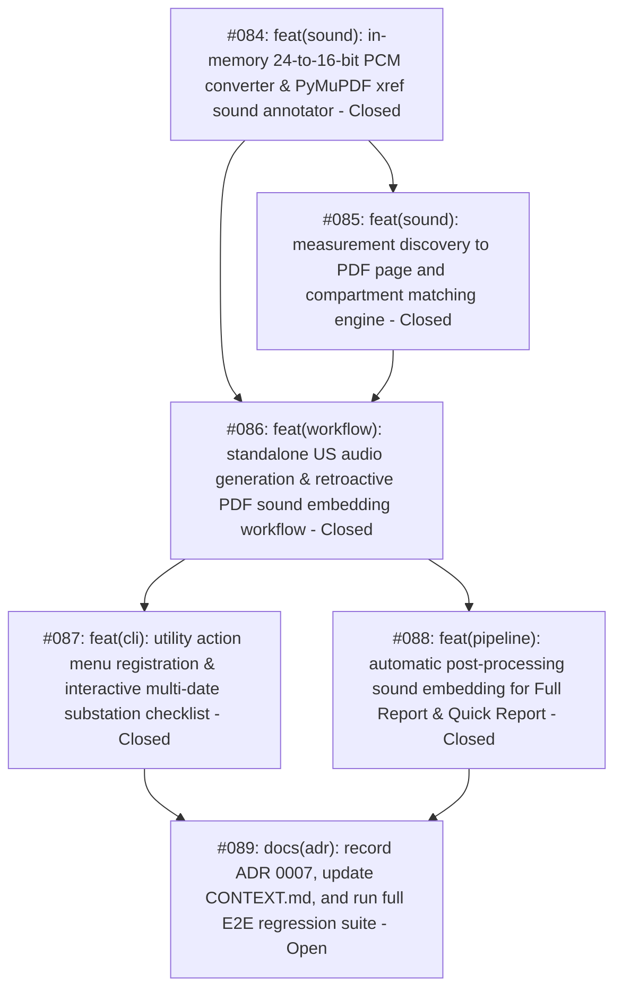

# Automated Ultrasound Audio Embedding & 16-Bit Audio Generation Map

> [!IMPORTANT]
> **Worktree & Branching Lifecycle Protocol**:
> 
> 1. **Dedicated Implementation Worktree**:
>    - All implementation work across tickets #084–#089 must be executed strictly inside a dedicated worktree:
>      - **Worktree Path**: `C:\Users\ADAM\Desktop\pahang-cli-audio`
>      - **Branch**: `feature/embed-ultrasound-audio` (branched from `main`).
>    - **Provisioning Command**:
>      ```powershell
>      git worktree add -b feature/embed-ultrasound-audio C:/Users/ADAM/Desktop/pahang-cli-audio main
>      ```
> 
> 2. **Multi-Session Agent Operating Invariants**:
>    - **Isolation Invariant**: Under no circumstances should implementation commits be pushed directly to `main` or performed inside `pahang-cli`, `pahang-cli-33kv`, or `pahang-cli-web`.
>    - **Session Handoff & Discovery**: When any agent begins or resumes a session:
>      1. Inspect `git -C C:/Users/ADAM/Desktop/pahang-cli-audio status` and `git -C C:/Users/ADAM/Desktop/pahang-cli-audio log -n 5 --oneline` to establish the exact commit state and verify what ticket was last finished.
>      2. Consult `.wayfinder/embed-ultrasound-audio-in-reports/map.md` to identify the next open ticket.
>      3. All file edits, test executions (`pytest`), and git commits must be targeted exclusively to `C:\Users\ADAM\Desktop\pahang-cli-audio`.
> 
> 3. **Merge Gate & Post-Implementation Synchronization Strategy**:
>    - **Phase A (Gate Verification in `pahang-cli-audio`)**:
>      - 100% green automated test suite (`pytest`) across all unit, workflow, CLI, and regression test suites.
>      - Complete manual verification and CLI dry-run inspection approved by human maintainer.
>    - **Phase B (Merge into `main` in `pahang-cli`)**:
>      ```powershell
>      cd C:\Users\ADAM\Desktop\pahang-cli
>      git checkout main
>      git merge --no-ff feature/embed-ultrasound-audio -m "feat(sound): merge feature/embed-ultrasound-audio (#084-#089)"
>      pytest tests/
>      ```
>    - **Phase C (Downstream Worktree Synchronization)**:
>      - To prevent branch drift, downstream worktrees must be sequentially updated with `main`:
>      - **`pahang-cli-33kv` (`feature/33kv-system`)**:
>        ```powershell
>        cd C:\Users\ADAM\Desktop\pahang-cli-33kv
>        git status  # verify working tree is clean
>        git merge main -m "chore(sync): merge main into feature/33kv-system"
>        pytest tests/
>        ```
>      - **`pahang-cli-web` (`feature/pwa-web-migration`)**:
>        ```powershell
>        cd C:\Users\ADAM\Desktop\pahang-cli-web
>        git status  # verify working tree is clean
>        git merge main -m "chore(sync): merge main into feature/pwa-web-migration"
>        ```
>    - **Phase D (Worktree Teardown)**:
>      - Once merged and synchronized, remove the temporary audio worktree:
>        ```powershell
>        cd C:\Users\ADAM\Desktop\pahang-cli
>        git worktree remove C:/Users/ADAM/Desktop/pahang-cli-audio
>        git branch -d feature/embed-ultrasound-audio
>        ```

---

## Destination
Deliver an automated ultrasound sound embedding engine (`src/postprocessing/sound_embedder.py` and `src/workflows/us_audio.py`) that converts UltraTEV 24-bit `8k.wav` files to 16-bit PCM in memory and embeds ISO 32000-1 Sound Annotations into Full Report and Quick Report deliverable PDFs (`<STEM>.pdf`) at `"Sound clip"` table cells. Includes standalone 16-bit WAV audio file regeneration into `<SUBSTATION>/RAW DATA/US+TEV/sounds/`, a dedicated CLI utility action labeled `"Generate US 16-bit audio & embed sounds into PDFs"` at Position #10 in the Utilities menu, seamless post-processing pipeline integration, and non-blocking resilience (`UsTevAudioResiliencePolicy`) when US+TEV raw data is missing on disk.

---

## Specification Reference
The authoritative specification for this effort is documented in [spec.md](./spec.md). It establishes the formal problem statement, 12 user stories, 9 core implementation decisions, testing seams, concrete file schemas, and out-of-scope boundaries. All tickets in this map implement vertical slices of this specification.

---

## Notes
- **Domain Model**: `UsAudioWorkflow`, `UsAudioOutputDirectory`, `UsTevAudioResiliencePolicy`, `SoundClipAnchorPolicy`, `DiscoveredMeasurement`, `SubstationIsolatedBatchResiliencePolicy`, `MultiDateSelectionPolicy`, `VcbAudioAttributionPolicy`, `TransformerAudioAttributionPolicy`, `RmuAudioAttributionPolicy`, `TwoTierPanelMatchingPolicy`, `AtomicPdfSavePolicy`, `IdempotentSoundEmbeddingPolicy`.
- **Relevant Skills**: `tdd`, `codebase-design`, `caveman-commit`, `unslop`, `smart-commit`.
- **Operating Invariant**: In-memory PCM conversion consumes zero disk space. `8k.wav` is mandatory for acoustic ultrasound points (fails loudly on missing file). When US+TEV raw material is omitted, report generation pipelines continue to completion without errors.

---

## Work Breakdown & Phasing



---

## Tickets

### #084: feat(sound): in-memory 24-to-16-bit audio converter & PyMuPDF sound annotator
- **Status**: Closed
- **GitHub Issue**: [#84](https://github.com/adamlarGit/pahang-cli/issues/84)
- **Blocked by**: None (can start immediately)
- **Ticket File**: [tickets/084-in-memory-audio-converter-and-sound-annotator.md](file:///C:/Users/ADAM/Desktop/pahang-cli/.wayfinder/embed-ultrasound-audio-in-reports/tickets/084-in-memory-audio-converter-and-sound-annotator.md)
- **Delivers**: `convert_24bit_wav_to_16bit_pcm` in `src/postprocessing/sound_embedder.py` downscaling 24-bit to 16-bit PCM frames in memory via `wave` and `bytearray` slice assignment (sample >> 8), `export_16bit_wav` file writer, low-level PyMuPDF ISO 32000-1 `/Subtype /Sound` annotation injection via `doc.update_stream()`, Column 2 icon centering (`SoundClipAnchorPolicy`), indirect `/Annots` xref resolution, `IdempotentSoundEmbeddingPolicy` stream update/replacement, and unit tests with synthetic WAV fixtures.

### #085: feat(sound): measurement discovery to PDF page and compartment matching engine
- **Status**: Closed
- **GitHub Issue**: [#85](https://github.com/adamlarGit/pahang-cli/issues/85)
- **Blocked by**: #084
- **Ticket File**: [tickets/085-measurement-to-page-matching-engine.md](file:///C:/Users/ADAM/Desktop/pahang-cli/.wayfinder/embed-ultrasound-audio-in-reports/tickets/085-measurement-to-page-matching-engine.md)
- **Delivers**: Modularization of shared 3-tier feeder matching engine (`find_swg_feeder_survey_dir`), `find_sound_clip_anchor` locating `"Sound clip"` text and computing speaker rectangle centered in Column 2 ($x \in [236, 254]\text{ pt}$), `TwoTierPanelMatchingPolicy` with Row 4 `Panel Name` extraction decoupling matching from `package`, prefix-tolerant transformer regex (`r"Tx No\.\s*[:\n\r]*(?:TX|Tx|TRANSFORMER)?\s*(\d+)"`), `VcbAudioAttributionPolicy` with deterministic multi-measurement tie-breaking ($UPPER\_BUSBARS > $LOWER\_BUSBARS; highest dB), `RmuAudioAttributionPolicy` with board-level acoustic fallback, mandatory `8k.wav` fail-loud verification, unit tests covering VCB cubicles, RMU, and Transformers.

### #086: feat(workflow): standalone US audio generation & retroactive PDF sound embedding workflow
- **Status**: Closed
- **GitHub Issue**: [#86](https://github.com/adamlarGit/pahang-cli/issues/86)
- **Blocked by**: #084, #085
- **Ticket File**: [tickets/086-standalone-audio-workflow-and-wav-export.md](file:///C:/Users/ADAM/Desktop/pahang-cli/.wayfinder/embed-ultrasound-audio-in-reports/tickets/086-standalone-audio-workflow-and-wav-export.md)
- **Delivers**: `UsAudioWorkflow` in `src/workflows/us_audio.py` supporting `"export_wav"`, `"embed_pdf"`, and `"both"` execution modes, `export_substation_16bit_wavs` saving canonical `{meas.label}.wav` files into `<SUBSTATION>/RAW DATA/US+TEV/sounds/`, `embed_survey_ultrasound_into_pdf` modifying PDFs atomically via `AtomicPdfSavePolicy` (with context manager, pre-flight unlink, and guarded cleanup), idempotent sound embedding, error isolation via `SubstationIsolatedBatchResiliencePolicy`, and graceful degradation via `UsTevAudioResiliencePolicy`.

### #087: feat(cli): utility action menu registration & interactive multi-date substation checklist
- **Status**: Closed
- **GitHub Issue**: [#87](https://github.com/adamlarGit/pahang-cli/issues/87)
- **Blocked by**: #086
- **Ticket File**: [tickets/087-cli-utility-action-and-substation-checklist.md](file:///C:/Users/ADAM/Desktop/pahang-cli/.wayfinder/embed-ultrasound-audio-in-reports/tickets/087-cli-utility-action-and-substation-checklist.md)
- **Delivers**: Discovery helper `discover_us_audio_candidate_substations`, interactive merged checklist `select_us_audio_substations_interactive` with `[{date_str}]` prefixes and deliverable PDF readiness tags (`[PDF READY]` vs `[NO PDF]`), actionable prompt on missing PDFs for Mode 1, runner factory `_load_generate_us_audio_runner()` with mode selection sub-menu, registration at Position #10 in `UTILITY_ACTIONS` with label `"Generate US 16-bit audio & embed sounds into PDFs"`, CLI integration unit tests.

### #088: feat(pipeline): automatic post-processing sound embedding for Full Report & Quick Report
- **Status**: Closed
- **GitHub Issue**: [#88](https://github.com/adamlarGit/pahang-cli/issues/88)
- **Blocked by**: #086 (can execute in parallel with #087)
- **Ticket File**: [tickets/088-pipeline-auto-integration-quick-and-full-report.md](file:///C:/Users/ADAM/Desktop/pahang-cli/.wayfinder/embed-ultrasound-audio-in-reports/tickets/088-pipeline-auto-integration-quick-and-full-report.md)
- **Delivers**: Post-merge sound embedding hook in `FullReportPostProcessingWorkflow._compile_deliverable` at unified exit point using Row 4 `Panel Name` extraction, post-merge hook in `PostProcessingPipelineWorkflow.execute` immediately following Quick Report PDF testsheet merge, idempotent sound injection, non-blocking diagnostic logging on missing raw survey data, pipeline integration unit tests.

### #089: docs(adr): record ADR 0007, update CONTEXT.md, and run full E2E regression suite
- **Status**: Open
- **GitHub Issue**: [#89](https://github.com/adamlarGit/pahang-cli/issues/89)
- **Blocked by**: #087, #088
- **Ticket File**: [tickets/089-adr-context-docs-and-e2e-verification.md](file:///C:/Users/ADAM/Desktop/pahang-cli/.wayfinder/embed-ultrasound-audio-in-reports/tickets/089-adr-context-docs-and-e2e-verification.md)
- **Delivers**: Formal `docs/adr/0007-ultrasound-audio-embedding-and-conversion.md`, updated `CONTEXT.md` with new domain concepts (`UsAudioWorkflow`, `UsAudioOutputDirectory`, `UsTevAudioResiliencePolicy`, `SoundClipAnchorPolicy`, `VcbAudioAttributionPolicy`, `TransformerAudioAttributionPolicy`, `RmuAudioAttributionPolicy`, `TwoTierPanelMatchingPolicy`, `AtomicPdfSavePolicy`, `IdempotentSoundEmbeddingPolicy`), manual CLI menu dry-run check, and 100% green run across the entire automated `pytest` test suite.

---

## Decisions so far
- **D1 (Audio Format)**: UltraTEV 24-bit PCM WAV files (`sampwidth=3`) are incompatible with ISO 32000-1 §13.3 and Adobe Acrobat. Downscaling to 16-bit PCM in memory via `wave` and `bytearray` slice assignment takes 1.2 ms with 0 bytes written to disk.
- **D2 (Authoritative & Mandatory Audio Track)**: Standardize strictly on `8k.wav` (heterodyne demodulated 0–4 kHz audible track, ~160 KB/page). Raw `192k.wav` is inaudible transducer data. `8k.wav` must exist and be non-empty; if missing, fails loudly with `FileNotFoundError` (zero fallback to `10k.wav` or `192k.wav`).
- **D3 (PyMuPDF Annotation Strategy & Idempotency)**: PyMuPDF 1.26.3 lacks high-level `page.add_sound_annot()`. Low-level PyMuPDF cross-reference (`xref`) API injects valid ISO 32000-1 `/Subtype /Sound` streams and links them to speaker annotations. Enforces `IdempotentSoundEmbeddingPolicy` (updates stream or replaces existing sound annot if one already intersects `sound_rect`) and resolves indirect `/Annots` xref objects cleanly.
- **D4 (Template Anchor & Icon Placement)**: Templates `swg-panel.docx` and `tx-hv-sides.docx` contain Row 31 key-value cells. To align with ultrasound measurement readings above, speaker annotation rectangle is centered in Column 2: `fitz.Rect(236.0, inst.y0 - 2, 254.0, inst.y1 + 2)` (`SoundClipAnchorPolicy`).
- **D5 (Shared Feeder Matching Engine)**: Reuses and modularizes 3-tier precedence matching (`find_swg_feeder_survey_dir`) across PRPD graphs and audio embedding.
- **D6 (Panel Resolution & Decoupling)**: `TwoTierPanelMatchingPolicy` extracts explicit digits from `Panel No.` (Tier 1), falling back to `SubstationTestsheetPackage` equipment panel list (Tier 2). Extracts Row 4 `Panel Name` from page text so `find_swg_feeder_survey_dir` resolves feeder folders directly even when `package` is `None`.
- **D7 (VCB Chamber Attribution & Disambiguation)**: `VcbAudioAttributionPolicy` enforces strict 1-to-1 physical chamber matching (`$CIRCUIT_BREAKER`, `$CABLE_BOX`, `$UPPER_BUSBARS`, `$VT_CHAMBER`) with zero cross-chamber leakage. Disambiguates multiple measurements by prioritizing `$UPPER_BUSBARS` over `$LOWER_BUSBARS` and choosing the highest dB reading for duplicate components. Unmeasured chambers stay blank.
- **D8 (Transformer HV Attribution & Prefix Tolerance)**: `TransformerAudioAttributionPolicy` shares a single TX acoustic recording across all active HV side scanning pages (`HV CABLE`, `HV BUSHING`, `HV CABLE SPLIT`). Tolerates optional `"TX"` / `"TRANSFORMER"` prefixes in `Tx No.` (`r"Tx No\.\s*[:\n\r]*(?:TX|Tx|TRANSFORMER)?\s*(\d+)"`).
- **D9 (RMU Attribution & Board Fallback)**: `RmuAudioAttributionPolicy` attributes single untagged US recordings to the panel's active scanning page (`CABLE COMPARTMENT`). When feeder subfolders are absent, falls back to attributing an overall board-level recording (`RMU_US`) across all active RMU cable compartments.
- **D10 (Systematic WAV Naming Parity)**: Reuses `meas.label` directly (`output_dir / f"{meas.label}.wav"`) for 100% naming parity and deduplication counter safety with PRPD graph generation.
- **D11 (Post-Merge Seam)**: Sound injection occurs strictly after Word COM export and testsheet merging on the final unified `<STEM>.pdf` deliverable at the unified exit of `_compile_deliverable` (passing `environment`) and Step 6 of Quick Report post-processing.
- **D12 (Atomic PDF Replacement & Handle Closure)**: `AtomicPdfSavePolicy` uses a context manager (`with fitz.open(...) as doc:`) to ensure handles are released, unlinks stale `.tmp_sound_{pdf.name}` pre-flight, and replaces atomically via `os.replace` within guarded `try...finally` blocks.
- **D13 (Missing Data Resilience)**: Follows `UsTevAudioResiliencePolicy`: if US+TEV raw data or individual compartment recordings are absent due to disk constraints, logs an `INFO` diagnostic and completes cleanly without failing or interrupting the batch.
- **D14 (Dual-Trigger Execution)**: Delivers both automatic execution during post-processing and retroactive on-demand execution via a dedicated CLI Utility Action.
- **D15 (Menu Placement & Readiness Tags)**: Placed at Position #10 (index 9) in `UTILITY_ACTIONS`. Candidate checklist indicates `[PDF READY]` vs `[NO PDF]` with an actionable prompt if Mode 1 is chosen with zero PDFs.
- **D16 (Batch Error Isolation)**: Follows `SubstationIsolatedBatchResiliencePolicy`: single-substation sound errors are trapped and reported in the summary without halting the remainder of the batch queue.

---

## Not yet specified
- None. The route from raw audio conversion to PDF annotation and CLI invocation is fully specified across tickets #084–#089.

---

## Out of scope
- Converting electrical TEV RF pulses into audio clips.
- Decoding or playing raw undemodulated `192k.wav` transducer data.
- Modifying Word `.docx` templates or table layout geometry.
- Embedding audio playback inside Microsoft Word `.docx` files (Word COM does not support embedded interactive audio).
