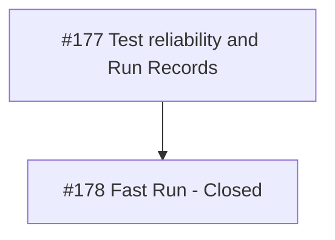

# Test reliability and Run Records

Parent specification: [#177](https://github.com/adamlarGit/pahang-cli/issues/177).
Integration branch: `feature/33kv-system`.

This local map records #178. The remaining child tickets stay tracked on GitHub;
this change does not implement or close them.

## #178 Make plain pytest a Fast Run on locked packages

- **Status**: Closed
- **Ticket**: [178-fast-run.md](tickets/178-fast-run.md)
- [x] Default selection excludes Office/live-data tests; Full Run selects every test.
- [x] Existing tests have Office/live-data markers and an Office activation guard.
- [x] Subprocess regression tests cover selection and missing-marker failures.
- [x] Pinned frozen commands and lockfile rationale are documented for developers and agents.
- [x] Test tools stay out of the app environment; no dependency group or lockfile change.
- [x] Suite validation leaves tracked PE157 benchmark files unchanged.

## Related work

- #179: baseline test failure triage.
- #180: parallel execution, Full Run ordering, and history.
- #182: performance targets.
- #183-#185: Run Records and detailed Steps.
