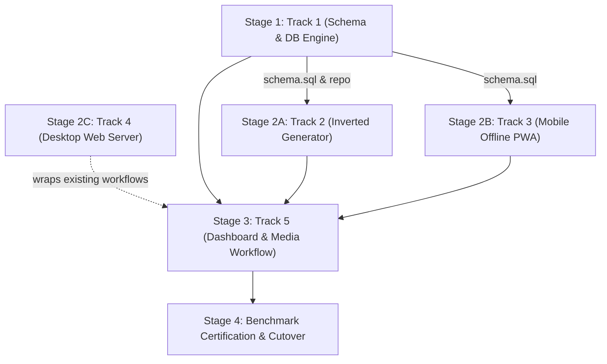

# Master Program Map: Web Migration, SQLite Testsheet & Mobile Field Data Entry

> [!IMPORTANT]
> **Program Planning Architecture**:
> - This is the **Master Program Map** (Tier 1). It provides the high-level roadmap, strategic migration framework, and coordinates the five specialized tracks.
> - Detailed decision tickets and execution frontiers live inside their respective **Track Sub-Maps** (Tier 2) under `tracks/`.
> - Maintained locally during design, migration staging, and fog-of-war resolution.

---

## Destination

Replace the interactive CLI with a dual-surface inspection and report automation platform:
1. An offline-capable mobile Progressive Web App (PWA) powered by client-side SQLite Wasm for field technicians to record substation inspections on Android/iOS without cellular connectivity.
2. A local Windows desktop webapp (FastAPI) for colleagues to orchestrate `WorkflowService`, COM automation, report generation, and media pairing on their laptops.
3. An inverted testsheet pipeline that replaces manual Excel parsing by generating client-compliant `PCE Testsheet` and `PCE VI` Excel/PDF documents directly from the SQLite database.

---

## Architecture Principles

- **Unified SQLite Everywhere**: Both mobile (browser Wasm + OPFS) and desktop (Python `sqlite3`) share the exact same relational table definitions. Transferring data from field to laptop uses direct SQLite database attachments (`ATTACH DATABASE`), eliminating fragile JSON serialization. SQLite is the sole input source of truth.
- **Dual-Surface Role Separation**:
  - *Mobile Surface*: Fast, touch-friendly, offline-first field data collection. Deployed as a static PWA via GitHub Pages with HTTPS; cached permanently offline via Service Worker; persisted locally in browser OPFS.
  - *Desktop Surface*: Heavy background processing, COM Word/Excel slicing, PDF compilation, and bulk camera SD card ingestion.
- **Zero Colleague Setup Overhead**: The desktop app runs locally on Windows laptops without requiring colleagues to install Node.js or configure external databases.
- **Output-Only Testsheet Compliance**: Client Excel and PDF layout requirements are satisfied by templating out from the database via a standalone generator, eliminating the need to parse handwritten Excel sheets while facilitating physical/wet-ink signing.
- **Client Deliverable vs Master Dump Isolation**: Unsorted camera SD dumps remain in `TESTSHEET/<STATION>/<MONTH>/<DATE>/UNSORTED RAW DATA/` as an immutable forensic master backup. Photo sorting strictly copies into `RAW MATERIAL/`, keeping `RAW MATERIAL/` pristine for client submission.

---

## Strategic Migration & Release Plan

### 1. Zero-Disruption Staging Model
The active production line on branch `main` must remain 100% operational for daily team CLI usage at all times.
- **Dedicated Staging Branch**: All migration tracks are developed and integrated inside branch `feature/pwa-web-migration`.
- **Git Worktree Isolation**: Development takes place in a dedicated worktree directory (e.g. `pahang-cli-web`), keeping the primary repository folder clean and instantly available to run or patch `main`.
- **Namespace Isolation (Dark Launching)**: All migration components are built in isolated namespaces (`src/db/`, `src/web/`, `src/generator/`, `web/pwa/`). Legacy CLI entry points (`src/workflow_cli.py`, `run_workflow.py`) remain untouched until the final cutover.
- **Urgent Fixes on Main**: Any mid-migration operational bugfixes committed to `main` are periodically merged into `feature/pwa-web-migration`.

### 2. Synchronized Dual-Surface Cutover
Because field technicians and laptop report compilers are the same individuals, rollout will be a synchronized cutover rather than a fragmented rollout:
- The team continues using the existing CLI throughout development.
- The mobile PWA and desktop web dashboard launch simultaneously once both are certified.
- **Definitive Sunset of Excel Input**: Once mobile PWA field entry is verified, manual Excel testsheet parsing is retired completely; Excel testsheets transition to strictly generated outputs for client compliance.
- **Forward-Only Database Storage**: SQLite stores all new inspections going forward starting from the cutover date. Historical Excel backfill is not required.

### 3. Stage Progression & Verification Gates

| Stage | Focus & Tracks | Deliverables | Verification Gate | Team Impact |
| :--- | :--- | :--- | :--- | :--- |
| **Stage 1: Foundation** | Track 1 | `schema.sql`, repository, composite key DDL, `DatabaseMergeService`, `TestsheetDomainAdapter` | Automated tests verify schema executes cleanly, composite keys prevent collisions, and `TestsheetDomainAdapter` achieves 100% attribute parity against legacy fixtures | Zero (Active on CLI) |
| **Stage 2: Concurrent Streams** | Tracks 2, 3, 4 | **Stream A (Track 2)**: `PceTestsheetRenderer`, `PceViRenderer`, standalone testsheet generator **Stream B (Track 3)**: Mobile PWA, GitHub Pages HTTPS deploy, SQLite Wasm + OPFS, wizard with station overrides, Web Share `.db` **Stream C (Track 4)**: FastAPI backend, SSE stream, COM STA worker, `.bat` launcher | **Stream A**: Pixel-compliant Excel workbooks and PDFs matching TNB templates. **Stream B**: Real device test (iOS/Android): 100% offline launch, data input with station override, and successful `.db` export. **Stream C**: Server executes workflows and streams SSE progress with COM STA isolation | Zero (Active on CLI) |
| **Stage 3: Integration & Media Workflow** | Track 5 | Web dashboard, drag-and-drop `.db` merger (clean-child replace), SD photo range matcher from `TESTSHEET/.../UNSORTED RAW DATA/` | Drag-and-drop `.db` import, non-destructive photo slicing, and execution of standalone testsheet and report workflows from dashboard | Zero (Active on CLI) |
| **Stage 4: Parity Certification & Cutover** | All | Full E2E parity suite against 3 canonical reference samples; merge `feature/pwa-web-migration` into `main`, deploy `start_webapp.bat`, PWA bookmark | **Deterministic Parity Gate**: Generated Quick Reports, Full Reports, and Testsheet PDFs achieve byte/layout equivalence with legacy CLI outputs for the 3 official reference samples (`005. TALAPIA`, `179. CENDERAWASIH NO.1`, `144. TELEKOM TANAH PUTIH`) | Full Switchover |

---

## Track Breakdown & Phasing

---

## Program Tracks (Tier 2 Sub-Maps)

### 🗺️ [Track 1: SQLite Domain Engine (Foundation)](./tracks/01-sqlite-domain-engine/map.md)
- **Status**: Ready to chart / Frontier (Stage 1)
- **Sub-map Path**: `tracks/01-sqlite-domain-engine/map.md`
- **Scope**: Canonical schema DDL with composite natural keys/UUIDs, Python SQLite repository, project database initialization (`<base_path>/pahang_project.db`), `ATTACH DATABASE` merge mechanics with clean-child replace (`D-MASTER.17`), and in-memory `TestsheetDomainAdapter` bridging SQLite records directly into `TestsheetData` entities (`D-MASTER.15`).

### 🗺️ [Track 2: Inverted Client Testsheet Generator](./tracks/02-inverted-testsheet-generator/map.md)
- **Status**: Blocked by Track 1 (Stream A)
- **Sub-map Path**: `tracks/02-inverted-testsheet-generator/map.md`
- **Scope**: Standalone testsheet generator reading `InspectionRecord` entities from SQLite, populating official template workbooks (`templates/softcopy_testsheet_v1.8.xlsx`) via `openpyxl`, and compiling client-compliant PDFs via `BatchComSession` Excel COM (`D-MASTER.18`). Outputs `.xlsx` and `.pdf` directly to `TESTSHEET/<STATION>/<MONTH>/<DATE>/` to accommodate physical/wet-ink signing by contractor and TNB supervisor.

### 🗺️ [Track 3: Mobile Offline PWA (Field Data Entry)](./tracks/03-mobile-offline-pwa/map.md)
- **Status**: Blocked by Track 1 Schema (Ticket 0101) (Stream B)
- **Sub-map Path**: `tracks/03-mobile-offline-pwa/map.md`
- **Scope**: 100% static PWA hosted on GitHub Pages with HTTPS (`D-MASTER.16`), Service Worker offline caching, SQLite Wasm + OPFS persistent storage, multi-step inspection form wizard with project profiles and station dropdown overrides (`D-MASTER.20`), and Web Share API `.db` file export.

### 🗺️ [Track 4: Desktop Web Server & Telemetry Engine](./tracks/04-desktop-web-server/map.md)
- **Status**: Ready to chart / Frontier (Stream C - Concurrent)
- **Sub-map Path**: `tracks/04-desktop-web-server/map.md`
- **Scope**: Local FastAPI server in `src/web/` wrapping `WorkflowService`, Server-Sent Events (SSE) telemetry, COM STA worker thread isolating Word/Excel automation, and colleague `.bat` launcher. Develops concurrently with Tracks 1, 2, and 3.

### 🗺️ [Track 5: Desktop Dashboard & Media Workflow](./tracks/05-desktop-dashboard-and-media/map.md)
- **Status**: Blocked by Tracks 1, 2, 3, 4 (Stage 3 Integration)
- **Sub-map Path**: `tracks/05-desktop-dashboard-and-media/map.md`
- **Scope**: Desktop UI cards replacing CLI menus, mobile `.db` drag-and-drop import with clean-child merge, non-destructive SD photo slicer reading `TESTSHEET/.../UNSORTED RAW DATA/` into `RAW MATERIAL/` with guided preview matrix (`D-MASTER.19`), standalone testsheet generation card, and workflow execution.

---

## Decisions so far

- **D-MASTER.1**: Full replacement of CLI with a local Windows desktop webapp.
- **D-MASTER.2**: Dual-surface split: mobile PWA for on-site data entry; local laptop webapp for heavy workflow execution.
- **D-MASTER.3**: Inverted testsheet model: database is the single source of truth; client-compliant Excel/PDF testsheets are generated from database records.
- **D-MASTER.4**: Offline-first mobile strategy: due to zero-reception substations, mobile runs fully offline.
- **D-MASTER.5**: SQLite Wasm + Python SQLite unified engine: identical schema on both ends; laptop merges mobile databases using `ATTACH DATABASE`.
- **D-MASTER.6**: Media ingestion stays on laptop for Phase 1: camera SD cards dump to master backup and pair with database inspections.
- **D-MASTER.7**: Per-project database storage: SQLite database file is stored at `<base_path>/pahang_project.db`.
- **D-MASTER.8**: Two-tier Wayfinder map architecture: master program map coordinating five dedicated track sub-maps.
- **D-MASTER.9**: Staging branch and worktree isolation: all development runs on `feature/pwa-web-migration` in a secondary worktree to protect the active production CLI on `main`.
- **D-MASTER.10**: Synchronized dual-surface rollout: mobile PWA and desktop web dashboard launch together once certified, as field technicians and report compilers are the same team members.
- **D-MASTER.11**: Definitive sunset of manual Excel input: upon mobile PWA certification, manual Excel testsheet parsing is retired completely; Excel testsheets become purely generated outputs.
- **D-MASTER.12**: Forward-only project database storage: SQLite database records new inspections starting from cutover date; historical Excel backfill is omitted.
- **D-MASTER.13**: Collision-free entity identity: schema enforces UUIDs or natural composite keys `(project_key, station, pe_num, inspection_date)` across all tables to ensure safe `ATTACH DATABASE` merges without auto-increment collisions.
- **D-MASTER.14**: Camera photo range linkage: mobile form wizard explicitly captures thermal (`IR`) and digital (`DG`) photo index ranges to feed desktop raw media pairing.
- **D-MASTER.15**: In-memory domain adapter seam: SQLite records are mapped directly into in-memory `TestsheetData` entities via `TestsheetDomainAdapter` (Ticket 0104), allowing downstream workflows (`QuickReportWorkflow`, `FullReportWorkflow`, `UpdateQr02CbaWorkflow`, `PopulateTotalPeWorkflow`, `WhatsAppReportWorkflow`) to consume database inspections without disk round-trips or breaking changes to report generation engines.
- **D-MASTER.16**: Static GitHub Pages PWA hosting: mobile PWA is deployed as a 100% static bundle to GitHub Pages over HTTPS, satisfying browser security requirements for Service Workers, OPFS (`SharedArrayBuffer`), and Web Share API without requiring local TLS certificate management.
- **D-MASTER.17**: Clean-child replace in database merger: `DatabaseMergeService` compares `updated_at` timestamps and purges existing child records (`switchgear_panels`, `panel_readings`, `defects`) for a substation before re-inserting from an imported `.db`, completely eliminating ghost rows caused by mobile deletions.
- **D-MASTER.18**: Standalone inverted testsheet workflow: testsheet generation runs as a dedicated workflow generating `.xlsx` and `.pdf` in `TESTSHEET/<STATION>/<MONTH>/<DATE>/` to accommodate physical/wet-ink signing by contractor and TNB supervisor prior to report compilation.
- **D-MASTER.19**: Unsorted raw media master dump isolation: unsorted camera SD card dumps remain in `TESTSHEET/<STATION>/<MONTH>/<DATE>/UNSORTED RAW DATA/` as immutable forensic master backups. Photo sorting strictly copies into `RAW MATERIAL/`, keeping `RAW MATERIAL/` pristine for client delivery.
- **D-MASTER.20**: Mobile project profile with per-substation override: mobile PWA sets default project metadata (PO, voltage, tester, default station) to prevent typing friction and PK typos, with per-substation dropdown overrides for multi-station inspection days.
- **D-MASTER.21**: Ground-truth benchmark verification: Stage 4 integration gate strictly requires end-to-end parity verification against the 3 official reference samples: `005. TALAPIA (IR+VI)`, `179. CENDERAWASIH NO.1 (IR+VI)`, and `144. TELEKOM TANAH PUTIH (TEV+VI)`.

---

## Not yet specified (Fog of war)

- **Peer-to-Peer Wi-Fi Hotspot Sync**: Direct browser-to-server sync over local Wi-Fi when technician connects to colleague's hotspot, graduating after manual file export is tested.
- **Mobile Camera In-App Capture**: Capturing condition and visual defect photos directly inside the mobile PWA (deferred to Phase 2).

---

## Out of scope

- **TNB Client Layout Changes**: Modifying the client's mandatory Excel/PDF structure (we generate their exact layout).
- **Cloud-Only Central Server**: Running the core engine exclusively in the cloud (prohibited by local Windows COM Word/Excel dependencies and large local raw media directories).
- **Historical Excel Testsheet Backfill**: Parsing past months' handwritten Excel workbooks into SQLite (forward-only model starting from cutover).
