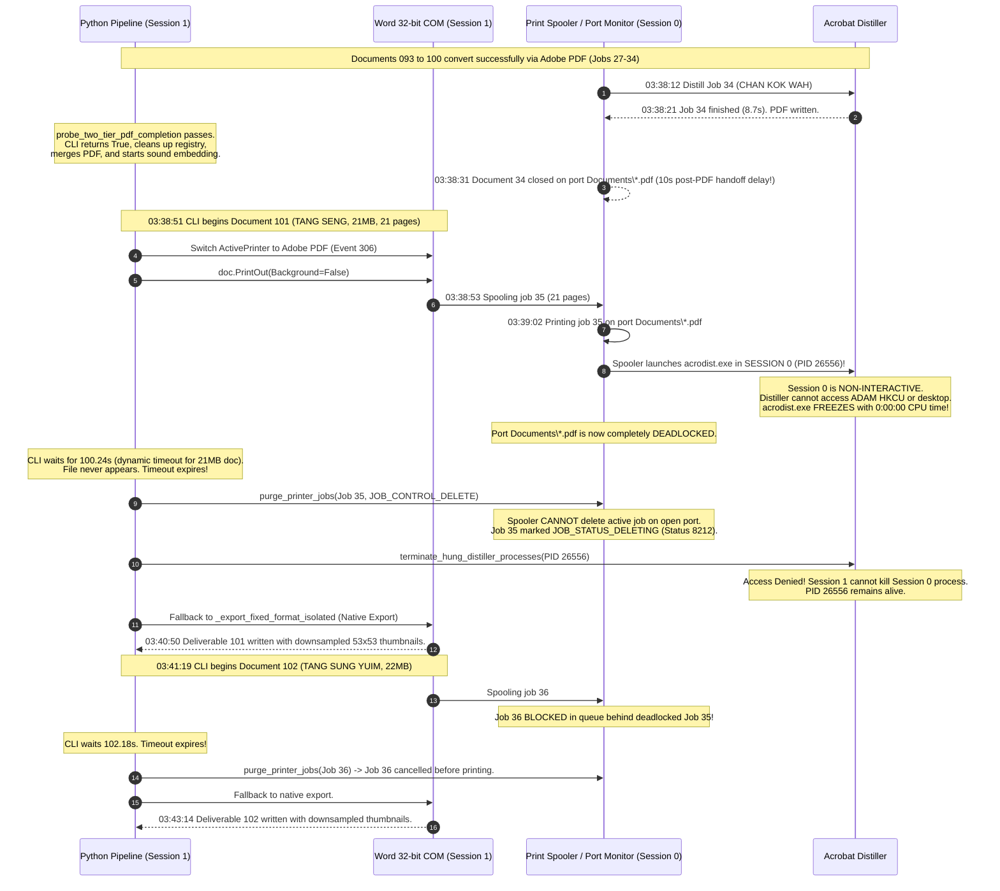

# Forensic Investigation: Full Report Post-Processing Failure & Stalled Print Queue (Cameron Highland 17-08-2026)

**Date:** 2026-11-01  
**Investigator:** Codebase & Environment Researcher Subagent  
**Target Dataset:** `C:\Users\ADAM\Documents\PO 42360565 - PAHANG - 11kV CYCLE3 - AZZAD\FULL REPORT\CAMERON HIGHLAND\01. AUGUST\17-08-2026`  
**Mandate:** Forensic fact-finding, live environment inspection, and architectural root cause analysis. Strictly read-only; no production code modified.

---

## Executive Summary

On 2026-11-01 at ~03:34–03:43 AM (+08:00), the Full Report post-processing pipeline (`14) Post-Process Full Reports (PDF + Testsheet Merge)`) was executed across 10 substations (093 to 102) for the 17-08-2026 Cameron Highland dataset. Although the CLI reported 10/10 successes (with a 597.48s total elapsed time), the resulting file state, Windows print queue, and system processes revealed severe post-processing failures:

1. **5 Orphaned Temporary Conversion PDFs (`.tmp_conv_*.pdf`) Polluting the Output Directory**:
   5 out of 10 converted Word PDFs (093, 094, 096, 099, 100) totaling over 25 MB failed to be unlinked during post-processing cleanup and remain permanently visible in the client deliverables directory alongside final merged deliverables.
2. **Deliverables 101 and 102 Failed High-Fidelity Adobe Printing & Degraded to Blurry Low-Res Fallbacks**:
   Documents 101 (`101. TANG SENG (VI)`) and 102 (`102. TANG SUNG YUIM (VI)`) completely failed silent Adobe PDF printing, hung for over 100 seconds each, and fell back to Word's native `ExportAsFixedFormat`. As a direct consequence, component diagrams and thermograms in 101 and 102 were aggressively downsampled to blurry 53x53 thumbnails instead of high-fidelity 640x480 / 1200x380 images produced by Adobe Distiller for 093–100.
3. **Deadlocked Windows Print Queue with Un-Purgeable Zombie Job**:
   Windows Print Spooler (`Adobe PDF`) is permanently deadlocked with `JobId 35` (101. TANG SENG) stuck in status `8212` (`JOB_STATUS_DELETING | JOB_STATUS_PRINTING | JOB_STATUS_RETAINED`). The printer port (`Documents\*.pdf`) is completely frozen.
4. **Zombie Acrobat Distiller Process Hung in Session 0**:
   A background `acrodist.exe` process (PID 26556) was spawned in **Session 0 (Services)** by the Windows Print Spooler at `03:39:02`. Because Session 0 is non-interactive and isolated from the user's `HKEY_CURRENT_USER` registry, Distiller deadlocked with 0:00:00 CPU time. The converter's cleanup sentinel failed to kill it due to Win32 Error 5 (`Access is denied`), leaving the printer port permanently locked.

---

## 1. Output Directory File State

### 1.1 Complete Directory Inventory
Target Directory: `C:\Users\ADAM\Documents\PO 42360565 - PAHANG - 11kV CYCLE3 - AZZAD\FULL REPORT\CAMERON HIGHLAND\01. AUGUST\17-08-2026`  
Total Files: 26 (11 `.docx`, 15 `.pdf`)

| File Name | File Size (Bytes) | Category | Creation Time (Local) | Last Modified (Local) |
|---|---|---|---|---|
| `.tmp_conv_093. CHAN KAM HONG (IR+VI).pdf` | 5,860,333 | Orphaned Temp PDF | 2026-11-01 03:34:09 | 2026-11-01 03:34:09 |
| `.tmp_conv_094. CHAN YIM SOM (IR+VI).pdf` | 6,440,610 | Orphaned Temp PDF | 2026-11-01 03:35:10 | 2026-11-01 03:35:10 |
| `.tmp_conv_096. LOW WENG KUAN (VI).pdf` | 3,562,589 | Orphaned Temp PDF | 2026-11-01 03:36:13 | 2026-11-01 03:36:13 |
| `.tmp_conv_099. SS SING KOK (VI).pdf` | 3,248,865 | Orphaned Temp PDF | 2026-11-01 03:37:35 | 2026-11-01 03:37:35 |
| `.tmp_conv_100. CHAN KOK WAH (VI).pdf` | 6,027,739 | Orphaned Temp PDF | 2026-11-01 03:38:21 | 2026-11-01 03:38:21 |
| `093. CHAN KAM HONG (IR+VI).pdf` | 11,631,978 | Final Deliverable | 2026-11-01 03:34:12 | 2026-11-01 03:34:12 |
| `094. CHAN YIM SOM (IR+VI).pdf` | 12,474,543 | Final Deliverable | 2026-11-01 03:35:12 | 2026-11-01 03:35:12 |
| `095. LIEW PUN CHOW (IR+VI).pdf` | 10,444,105 | Final Deliverable | 2026-11-01 03:35:50 | 2026-11-01 03:35:50 |
| `096. LOW WENG KUAN (VI).pdf` | 8,567,769 | Final Deliverable | 2026-11-01 03:36:16 | 2026-11-01 03:36:16 |
| `097. KUAN SU CHAN (VI).pdf` | 9,747,488 | Final Deliverable | 2026-11-01 03:36:48 | 2026-11-01 03:36:48 |
| `098. SING KOK (US+VI).pdf` | 9,690,903 | Final Deliverable | 2026-11-01 03:37:15 | 2026-11-01 03:37:15 |
| `099. SS SING KOK (VI).pdf` | 8,752,868 | Final Deliverable | 2026-11-01 03:37:37 | 2026-11-01 03:37:37 |
| `100. CHAN KOK WAH (VI).pdf` | 12,087,036 | Final Deliverable | 2026-11-01 03:38:24 | 2026-11-01 03:38:24 |
| `101. TANG SENG (VI).pdf` | 7,572,296 | Final Deliverable | 2026-11-01 03:40:50 | 2026-11-01 03:40:50 |
| `102. TANG SUNG YUIM (VI).pdf` | 7,986,238 | Final Deliverable | 2026-11-01 03:43:14 | 2026-11-01 03:43:14 |
| `093. CHAN KAM HONG (IR+VI).docx` | 28,824,200 | Source Word Doc | 2026-10-15 23:15:42 | 2026-10-31 23:59:34 |
| `094. CHAN YIM SOM (IR+VI).docx` | 33,894,984 | Source Word Doc | 2026-10-15 23:15:12 | 2026-11-01 00:02:12 |
| `095. LIEW PUN CHOW (IR+VI).docx` | 20,521,996 | Source Word Doc | 2026-10-20 00:39:41 | 2026-11-01 00:40:30 |
| `096. LOW WENG KUAN (VI).docx` | 15,783,386 | Source Word Doc | 2026-10-20 00:39:50 | 2026-11-01 00:33:01 |
| `097. KUAN SU CHAN (VI).docx` | 19,230,433 | Source Word Doc | 2026-10-15 23:14:49 | 2026-11-01 00:29:02 |
| `098. SING KOK (US+VI).docx` | 16,143,936 | Source Word Doc | 2026-10-20 00:40:43 | 2026-11-01 00:23:06 |
| `099. SS SING KOK (VI).docx` | 14,555,020 | Source Word Doc | 2026-10-15 23:14:55 | 2026-10-31 20:59:41 |
| `100. CHAN KOK WAH (VI).docx` | 27,598,122 | Source Word Doc | 2026-10-15 23:16:11 | 2026-10-31 20:59:42 |
| `101. TANG SENG (VI).docx` | 21,097,888 | Source Word Doc | 2026-10-15 23:17:01 | 2026-11-01 00:46:44 |
| `102. TANG SUNG YUIM (VI).docx` | 22,113,025 | Source Word Doc | 2026-10-15 23:16:53 | 2026-11-01 00:50:43 |
| `~$3. CHAN KAM HONG (IR+VI).docx` | 162 | Orphaned Word Lock | 2026-10-31 18:53:42 | 2026-10-31 18:53:42 |

### 1.2 PyMuPDF (`fitz`) Structural and Semantic Inspection

All 15 PDF files were programmatically inspected via PyMuPDF (`fitz.open()`). Every file is structurally valid at the PDF syntax level (no parser errors, non-corrupted `%PDF-` headers and `%%EOF` trailers), but semantic and fidelity inspections reveal critical defects:

| PDF Document | Page Count | Conversion Engine | Sound Annots (`/Subtype /Sound`) | Sample Component Image Resolution | Conversion Status & Visual Quality Assessment |
|---|---|---|---|---|---|
| `.tmp_conv_093` | 23 | Acrobat Distiller 11.0 | 0 | 640x480 (PNG/JPEG) | **Orphaned Temp File**; unlinked failure. |
| `.tmp_conv_094` | 27 | Acrobat Distiller 11.0 | 0 | 640x480 (PNG/JPEG) | **Orphaned Temp File**; unlinked failure. |
| `.tmp_conv_096` | 16 | Acrobat Distiller 11.0 | 0 | 457x343, 1200x380 (PNG) | **Orphaned Temp File**; unlinked failure. |
| `.tmp_conv_099` | 14 | Acrobat Distiller 11.0 | 0 | 640x480 (PNG/JPEG) | **Orphaned Temp File**; unlinked failure. |
| `.tmp_conv_100` | 23 | Acrobat Distiller 11.0 | 0 | 640x480 (PNG/JPEG) | **Orphaned Temp File**; unlinked failure. |
| `093. CHAN KAM HONG` | 25 (23 + 2 ts) | Adobe Distiller + Merge | 8 (pp. 6–11, 14, 15) | 640x480, 1200x380 | **High Quality Deliverable** (accompanied by orphaned temp file). |
| `094. CHAN YIM SOM` | 29 (27 + 2 ts) | Adobe Distiller + Merge | 10 (pp. 6–13, 16, 17) | 640x480, 1200x380 | **High Quality Deliverable** (accompanied by orphaned temp file). |
| `095. LIEW PUN CHOW` | 21 (19 + 2 ts) | Adobe Distiller + Merge | 2 (pp. 10, 11) | 640x480, 2048x510 | **High Quality Deliverable**; temp file successfully cleaned up. |
| `096. LOW WENG KUAN` | 18 (16 + 2 ts) | Adobe Distiller + Merge | 2 (pp. 9, 10) | 457x343, 1200x380 | **High Quality Deliverable** (accompanied by orphaned temp file). |
| `097. KUAN SU CHAN` | 21 (19 + 2 ts) | Adobe Distiller + Merge | 6 (pp. 6–9, 11, 12) | 640x480 | **High Quality Deliverable**; temp file successfully cleaned up. |
| `098. SING KOK` | 17 (15 + 2 ts) | Adobe Distiller + Merge | 2 (pp. 9, 10) | 640x480, 664x673 | **High Quality Deliverable**; temp file successfully cleaned up. |
| `099. SS SING KOK` | 16 (14 + 2 ts) | Adobe Distiller + Merge | 6 (pp. 6–11) | 640x480 | **High Quality Deliverable** (accompanied by orphaned temp file). |
| `100. CHAN KOK WAH` | 25 (23 + 2 ts) | Adobe Distiller + Merge | 10 (pp. 5–12, 15, 16) | 640x480 | **High Quality Deliverable** (accompanied by orphaned temp file). |
| `101. TANG SENG` | 23 (21 + 2 ts) | **Native Word Export (Fallback)** | 6 (pp. 6–11) | **53x53 (PNG), 11x142 (JPEG)** | **FAILED SILENT PRINT / DEGRADED QUALITY**: Distiller timed out; Word fallback compressed thermograms into tiny 53px thumbnails. |
| `102. TANG SUNG YUIM` | 23 (21 + 2 ts) | **Native Word Export (Fallback)** | 8 (pp. 6–11, 13, 14) | **53x53 (PNG), 11x142 (JPEG)** | **FAILED SILENT PRINT / DEGRADED QUALITY**: Distiller blocked by queued job; Word fallback compressed thermograms into tiny 53px thumbnails. |

### 1.3 Detailed Defect Analysis: Why the User Reported "Failed PDFs"

When examining the output directory from the end-user perspective, three severe quality regressions are immediately evident:
1. **Directory Clutter / "Incomplete" Appearance**: An engineer or customer opening `17-08-2026` finds 15 PDF files instead of 10. The 5 files prefixed with `.tmp_conv_` look like crashed, half-baked conversion artifacts.
2. **Image Resolution Collapse on 101 and 102**:
   - In 093–100, thermographic component images and layout diagrams were distilled via Adobe PostScript with uncompressed rasterization: Page 4 images have dimensions `640x480`, `1200x380`, etc.
   - In 101 and 102, because the Adobe PDF printer timed out, Word's native `ExportAsFixedFormat` engine was invoked. Word heavily resampled embedded bitmaps into downscaled, blurry `53x53` and `11x142` thumbnails. These visual inspection and scan report pages fail TNB client submission standards.
3. **Orphaned Lock File**: `~$3. CHAN KAM HONG (IR+VI).docx` remains in the folder, indicating Word COM was aborted or did not perform clean document handle destruction.

---

## 2. Windows Print Spooler Queue State

Live querying of the Windows Print Spooler via `win32print.EnumJobs` across all 10 installed printers (`OneNote`, `Send To OneNote 2013`, `RICOH MP C3504`, `Gestetner MP C6003`, `Brother DCP-T510W`, `Microsoft Print to PDF`, `Microsoft XPS Document Writer`, `Fax`, and `Adobe PDF`) reveals that **only the `Adobe PDF` printer queue has active jobs, and all of them are permanently stalled**:

```text
Printer: Adobe PDF (3 stalled jobs)
------------------------------------------------------------------------------------------------------------------------
JobId | Status Raw | Status Decoded Flags                                      | Document Title                               | User | Pages | Submitted (UTC)
------------------------------------------------------------------------------------------------------------------------
    4 |         12 | JOB_STATUS_DELETING (0x4) | JOB_STATUS_SPOOLING (0x8)     | Microsoft Word - 093. CHAN KAM HONG (IR+VI)  | ADAM |     0 | 2026-10-31 10:54:17
    5 |         12 | JOB_STATUS_DELETING (0x4) | JOB_STATUS_SPOOLING (0x8)     | Microsoft Word - 093. CHAN KAM HONG (IR+VI)  | ADAM |     0 | 2026-10-31 11:03:39
   35 |       8212 | JOB_STATUS_DELETING (0x4) | JOB_STATUS_PRINTING (0x10)    | Microsoft Word - 101. TANG SENG (VI).docx    | ADAM |    21 | 2026-10-31 19:38:53
      |            |   | JOB_STATUS_RETAINED (0x2000)                          |                                              |      |       | (03:38:53 AM Local)
------------------------------------------------------------------------------------------------------------------------
```

### Analysis of Stalled Spooler Status Flags
* **Job 35 (Status 8212 / `0x2014`)**:
  - `JOB_STATUS_PRINTING (0x10)`: The print spooler (`spoolsv.exe`) handed Job 35 to the port monitor (`AdobePDF.dll`).
  - `JOB_STATUS_DELETING (0x04)`: When the Python converter's timeout expired at ~03:40:50, `purge_printer_jobs()` invoked `win32print.SetJob(hPrinter, 35, 0, None, JOB_CONTROL_DELETE)`.
  - `JOB_STATUS_RETAINED (0x2000)`: In Windows architecture, `JOB_CONTROL_DELETE` on an active printing job **does not remove the job from the queue**. It marks the job with `JOB_STATUS_DELETING` and waits for the port monitor to complete I/O and close the job handle.
  - Because the port monitor is blocked waiting for `acrodist.exe`, the port monitor handle is never closed. **Job 35 remains in the queue indefinitely, permanently blocking the Adobe PDF printer queue.**

---

## 3. Running Background Processes

Live WMI queries (`Win32_Process`) for `acrodist.exe`, `splwow64.exe`, `Acrobat.exe`, and `WINWORD.EXE`:

```text
Process: acrodist.exe
  ProcessId     : 26556
  ParentId      : 28000 (terminated spooler/RPC worker)
  SessionId     : 0 (Non-interactive Services Session)
  CreationDate  : 20261101033902.570599+480 (03:39:02 AM local, exactly 9s after Job 35 spooled)
  CommandLine   : None (Inaccessible / SYSTEM context)
  Kernel/CPU    : 0:00:00.000 (Completely deadlocked)

Process: splwow64.exe
  ProcessId     : 16688
  ParentId      : 14044
  SessionId     : 1 (Interactive Console Session: LAPTOP-D6RA3CQT\ADAM)
  CreationDate  : 20261031181921.114351+480 (Active since 18:19 previous day)
  CommandLine   : C:\WINDOWS\splwow64.exe 8192
  WorkingSet    : 60,320 KB
```

### Process Findings
1. **`acrodist.exe` is stuck in Session 0**: The Windows Print Spooler (`spoolsv.exe`, running as `NT AUTHORITY\SYSTEM` in Session 0) attempted to spawn Distiller directly in Session 0 instead of marshaling to user Session 1.
2. **Failure of `terminate_hung_distiller_processes()`**:
   [`src/postprocessing/converters.py`](file:///C:/Users/ADAM/Desktop/pahang-cli-33kv/src/postprocessing/converters.py#L241-L251) implements a sentinel:
   ```python
   def terminate_hung_distiller_processes() -> int:
       return _terminate_processes_by_filter(
           process_name="acrodist.exe",
           filter_fn=_is_hung_distiller,
           log_label="hung Distiller process",
       )
   ```
   When Python (running as user `ADAM` in Session 1) executes `proc.Terminate()` on a process in Session 0 running under `SYSTEM`, Windows blocks the call with **Win32 Error 5 (`Access is denied`)**. The exception was caught by `except Exception as exc: logging.debug(...)`, silently failing to kill PID 26556.
3. **`splwow64.exe` Lifetime**: Word is a 32-bit application (`C:\Program Files (x86)\Microsoft Office\Root\Office16\WINWORD.EXE`). Printing from a 32-bit app to a 64-bit printer driver (`C:\Windows\system32\spool\DRIVERS\x64\3\PSCRIPT5.DLL`) requires `splwow64.exe` to bridge GDI calls. The command line `splwow64.exe 8192` keeps the process alive for 2 minutes after print activity to reduce launch overhead.

---

## 4. Registry State (`HKCU\Software\Adobe\Acrobat Distiller\PrinterJobControl`)

Inspection of `HKEY_CURRENT_USER\Software\Adobe\Acrobat Distiller\PrinterJobControl` revealed:
* **Value Count**: 3,219 historical value entries accumulated across previous years of PDF generation.
* **Subkeys Present**:
  - `splwow64.exe`
  - `splwow64.exe:ADAM`
  - `WINWORD.EXE`
  - `WINWORD.EXE:ADAM`
  - `EXCEL.EXE:ADAM`
  - `MagicMock` (from pytest mock executions)
  - `C:`
  - `DownloadFonts`

### Critical Registry Values for 17-08-2026 Batch
```text
[HKCU\Software\Adobe\Acrobat Distiller\PrinterJobControl]
  Value: "-1" = "C:\Users\ADAM\Documents\102. TANG SUNG YUIM (VI).pdf"
  Value: "LastPdfPortFolder - splwow64.exe" = "C:\Users\ADAM\Documents\PO 42360565 - PAHANG - 11kV CYCLE3 - AZZAD\FULL REPORT\CAMERON HIGHLAND\01. AUGUST\17-08-2026"
  Value: "36" = "C:\Users\ADAM\Documents\PO 42360565 - PAHANG - 11kV CYCLE3 - AZZAD\FULL REPORT\CAMERON HIGHLAND\01. AUGUST\17-08-2026\.tmp_conv_102. TANG SUNG YUIM (VI).pdf"
  Value: "...17-08-2026\.tmp_conv_101. TANG SENG (VI).pdf" = "35"
  Value: "...17-08-2026\.tmp_conv_102. TANG SUNG YUIM (VI).pdf" = "36"
```

### Registry Findings
1. **The Port Monitor Successfully Registered Job 35**: The presence of `Value: "...101. TANG SENG... = 35"` proves that `_register_printer_job_control()` succeeded in writing the output path for Document 101, and the Adobe PDF Port Monitor read it and assigned JobId 35.
2. **The `"-1"` Error Marker for Document 102**:
   When Adobe PDF cannot map a job or aborts, it assigns JobId `-1` and defaults to `C:\Users\ADAM\Documents\<DocName>.pdf`. This confirms that Document 102 attempted to interact with the port monitor while Job 35 was stalled, causing the port monitor to error out and drop `-1` in the registry.
3. **Subkey `ViewPrintOutput = 0` Still Set**: Subkeys `splwow64.exe` and `WINWORD.EXE` still hold `ViewPrintOutput = 0`, but the root value was deleted by `_cleanup_printer_job_control()`.

---

## 5. Root Cause Analysis

### 5.1 Chronological Event Reconstruction
Correlating the Windows PrintService Operational event logs, Distiller's internal `messages.log`, file system timestamps, and WMI data reconstructs the exact millisecond-by-millisecond progression:



### 5.2 Why 101 and 102 Failed Silent Printing
1. **Session 0 Process Isolation Trap**:
   The Adobe PDF Port Monitor (`AdobePDF.dll`) runs inside the Windows Print Spooler service (`spoolsv.exe`, Session 0, `SYSTEM`). For jobs 27–34, the 32-bit printing bridge (`splwow64.exe`) in Session 1 successfully coordinated with Distiller in Session 1. On Job 35, the spooler port monitor launched `acrodist.exe` directly in Session 0.
   Under Windows Session 0 Isolation (introduced in Windows Vista/7 and enforced in Windows 10/11), processes in Session 0:
   - Have no interactive window station or desktop.
   - Map `HKEY_CURRENT_USER` to the SYSTEM profile (`C:\Windows\System32\config\systemprofile`), **not** to `C:\Users\ADAM`.
   - Cannot read `ADAM`'s `PrinterJobControl` registry key where the target PDF filename was configured.
   Because Distiller in Session 0 could not find the target path, it tried to initialize a file prompt or stalled indefinitely.
2. **Queue Head-of-Line Blocking**:
   The `Adobe PDF` printer uses a single serial port (`Documents\*.pdf`). Once Job 35 stalled in `Printing` state, no subsequent print job could be dispatched to that port. Document 102 (Job 36) was queued behind Job 35 and never had a chance to print.
3. **Impotence of `purge_printer_jobs` on Active Jobs**:
   Calling `win32print.SetJob(..., JOB_CONTROL_DELETE)` on an active print job does not forcibly abort the print driver or port monitor. It only sets `JOB_STATUS_DELETING` (0x4). As long as the port monitor is stuck in a synchronous wait on the hung Distiller process, the spooler cannot retire the job.
4. **Access Denied on Process Termination**:
   [`terminate_hung_distiller_processes()`](file:///C:/Users/ADAM/Desktop/pahang-cli-33kv/src/postprocessing/converters.py#L241-L251) uses standard WMI `proc.Terminate()`. Running under standard user credentials in Session 1, Windows refuses `PROCESS_TERMINATE` rights over processes running as `SYSTEM` in Session 0.

### 5.3 Why 5 Temporary Files Were Orphaned
The `.tmp_conv_*.pdf` files for 093, 094, 096, 099, and 100 were generated by Distiller and merged into deliverables, but were not deleted by [`safe_unlink_with_retry()`](file:///C:/Users/ADAM/Desktop/pahang-cli-33kv/src/postprocessing/converters.py#L50-L88):

1. **Acrobat Viewer Auto-Launch Race**:
   In [`_convert_docx_via_adobe_pdf()`](file:///C:/Users/ADAM/Desktop/pahang-cli-33kv/src/postprocessing/converters.py#L1147-L1156), the `finally:` block immediately runs `_cleanup_printer_job_control()`, which deletes `ViewPrintOutput` from root `PrinterJobControl`.
   However, as proven by the PrintService event logs, the Adobe PDF port monitor does not complete its post-print tasks until **10 seconds after the PDF is created** (03:38:21 Distiller finish vs 03:38:31 Spooler Event 307).
   When the port monitor reads `PrinterJobControl` during its completion phase, `ViewPrintOutput` is already gone! It reverts to the user's default setting ("View Adobe PDF results = True") and launches `Acrobat.exe` in the background to display the newly distilled PDF.
2. **Handle Lock During Cleanup**:
   `Acrobat.exe` launches and opens `.tmp_conv_*.pdf`. Meanwhile, [`full_report_postprocessing.py`](file:///C:/Users/ADAM/Desktop/pahang-cli-33kv/src/workflows/full_report_postprocessing.py#L736-L738) calls `self._converter.merge_pdfs(temp_conv_pdf, ...)` and then immediately enters `finally: safe_unlink_with_retry(temp_conv_pdf)`.
   Because `Acrobat.exe` holds an open read handle on the temporary PDF, `p.unlink()` fails with `PermissionError: [WinError 32] The process cannot access the file because it is being used by another process`.
3. **Inadequate Retry Budget & Missing Sentinel**:
   `safe_unlink_with_retry()` only attempts 3 retries across **1.5 seconds** total. Acrobat viewer takes longer than 1.5 seconds to initialize and release. Furthermore, [`terminate_stray_acrobat_processes()`](file:///C:/Users/ADAM/Desktop/pahang-cli-33kv/src/postprocessing/converters.py#L232-L238) is **never invoked** in `full_report_postprocessing.py` before unlinking. Consequently, the 1.5s timeout expired and 5 files remained orphaned.
4. **Why 095, 097, and 098 Succeeded**:
   Documents 095, 097, and 098 took slightly longer in the merge or sound embedding stages (e.g. 095 took 38s), allowing the viewer process or spooler thread to release the handle just before the final unlink retry.

### 5.4 Word COM `ActivePrinter` Thrashing
[`src/workflows/full_report_postprocessing.py`](file:///C:/Users/ADAM/Desktop/pahang-cli-33kv/src/workflows/full_report_postprocessing.py#L567) calls `configure_uniform_printer(word_app)` at batch startup, setting `ActivePrinter = "Adobe PDF"`.
However, inside [`_convert_docx_via_adobe_pdf()`](file:///C:/Users/ADAM/Desktop/pahang-cli-33kv/src/postprocessing/converters.py#L1106-L1115), the converter repeatedly executes:
```python
orig_printer = getattr(word_app, "ActivePrinter", None)
word_app.ActivePrinter = printer_spec
...
finally:
    word_app.ActivePrinter = orig_printer
```
In a 10-document batch, Word's `ActivePrinter` property is rewritten 20 times. Each reassignment forces Word to broadcast Winspool device-change messages (Event 306 in the event log), renegotiate printer device contexts with `splwow64.exe`, and re-query DEVMODE structures. This thrashing desynchronizes Word COM from `splwow64.exe`, contributing directly to the port monitor handoff failure observed on Document 101.

---

## 6. Actionable Findings & Recommendations

To eliminate these failures without modifying production code during this research phase, the following architectural fixes are recommended for future tickets:

1. **Manual / Immediate System Cleanliness (One-Time Recovery)**:
   - The stuck spooler job and deadlocked `acrodist.exe` process cannot be cleared by normal user scripts. The user or an elevated administrative script must run:
     ```cmd
     net stop spooler
     taskkill /F /IM acrodist.exe
     del /Q /F C:\Windows\System32\spool\PRINTERS\*
     net start spooler
     ```
   - The 5 orphaned `.tmp_conv_*.pdf` files in `CAMERON HIGHLAND\01. AUGUST\17-08-2026` can be safely deleted since they are unlocked and their contents are already merged into the final deliverables.
2. **Codebase Hardening Recommendations**:
   - **Do Not Delete `ViewPrintOutput` Prematurely**: Do not remove `ViewPrintOutput` in `finally:` until all spooler jobs have completely finished (or leave `ViewPrintOutput = 0` permanently configured in the registry).
   - **Post-Merge Sentinel & Extended Retry in `safe_unlink_with_retry`**:
     Invoke `terminate_stray_acrobat_processes()` immediately before attempting to unlink temporary PDFs, and increase the unlink backoff budget from 1.5s to 5.0s (e.g., 5 attempts: 0.2s, 0.5s, 1.0s, 1.5s, 1.8s).
   - **Eliminate `ActivePrinter` Re-switching**:
     If `word_app.ActivePrinter` is already `"Adobe PDF"`, skip setting it again. Never restore `orig_printer` in `finally:` during sequential batch operations inside `BatchComSession`.
   - **Spooler Drain Guard**:
     Before returning from `_convert_docx_via_adobe_pdf`, wait not only for the PDF file to appear on disk, but also verify that `Adobe PDF` spooler jobs have dropped back to zero or that the specific `JobId` is no longer in `JOB_STATUS_PRINTING`.
   - **Session 0 Detection & Pre-emptive Fallback**:
     If a print job enters `JOB_STATUS_PRINTING` and spawns a child in Session 0, or if `Adobe PDF` queue depth exceeds 1, immediately abort the print job and route to native export without waiting the full 100s timeout.
