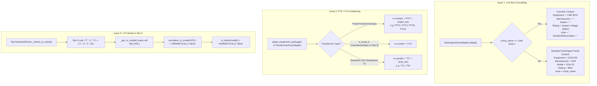

# Full Report Investigation: Link Box, PTX/LTX Numbering, and LTX Model

**Date:** 2026-10-28  
**Scope:** Primary source fact-finding and forensic code investigation of 3 Full Report issues reported by the user across docx deliverables, testsheets, and codebase architecture.  
**Constraint:** Fact-finding and research only. No production codebase files modified.

---

## Executive Summary

| Issue | Root Cause | Affected Primary Files | Proposed Solution Seam |
|---|---|---|---|
| **Issue 1: "LINK BOX" Compartment Formatting** | `SwitchgearScanAdapter.adapt()` populates all switchgear bay compartments using the parent switchgear/panel attributes (`GIS`/`VCB`, `36kV`, breaker status, busbar position, cable type, panel serial). For `LINK BOX`, the user requires external equipment semantics: Equipment=`LINK BOX`, Manufacturer=`-`, Model=`-`, Rating=`33kV` (system rating), Area=`-`, Serial No=`-`, CB Position=`-`, Busbar Position=`-`, Cable Type=`-`. | [`src/full_report/scan_adapters.py`](file:///C:/Users/ADAM/Desktop/pahang-cli-33kv/src/full_report/scan_adapters.py#L810-L840) | Add Link Box context override in `SwitchgearScanAdapter.adapt()` when `comp_name == "LINK BOX"`. |
| **Issue 2: PTX and LTX Transformer Numbering** | `normalize_tx_id()` formats all transformers as `TX{n}` or `TX{raw}` (e.g., `TX1`, `TX2`, `TXLOCAL TX`). `TransformerScanAdapter` does not differentiate `PowerTransformerSpec` (`PTX1`, `PTX2`, `PTX3`, `PTX4`) vs local station service transformer `TransformerSpec` (`LTX`) when constructing `tx.number` / `tx_id_str`. | [`src/core/normalizers.py`](file:///C:/Users/ADAM/Desktop/pahang-cli-33kv/src/core/normalizers.py#L616-L640), [`src/full_report/scan_adapters.py`](file:///C:/Users/ADAM/Desktop/pahang-cli-33kv/src/full_report/scan_adapters.py#L1053-L1060), [`src/full_report/scan_adapters.py`](file:///C:/Users/ADAM/Desktop/pahang-cli-33kv/src/full_report/scan_adapters.py#L1660-L1675) | Route transformer numbering by archetype (`PTX{i}` for power transformers, `LTX` for local station service transformers, `TX{i}` for standard distribution transformers). |
| **Issue 3: LTX Model Extracted as "-" Instead of "HERMETICALLY SEAL"** | `PpuTestsheetParser._extract_tx_sheet()` defines Slot 5 (LOCAL TX) columns as `("T", "U", "V")`. The testsheet has `MODEL:` in cell `V6` and `H/S` in cell `W6`. Because column `W` was omitted from Slot 5 `cols`, `_get_tx_model()` returned `""`, leading `normalize_tx_model("")` to evaluate to `"-"`. | [`src/testsheet/parsers/ppu.py`](file:///C:/Users/ADAM/Desktop/pahang-cli-33kv/src/testsheet/parsers/ppu.py#L1076), [`src/testsheet/parsers/ppu.py`](file:///C:/Users/ADAM/Desktop/pahang-cli-33kv/src/testsheet/parsers/ppu.py#L1448-L1467) | Expand Slot 5 column tuple in `_extract_tx_sheet` from `("T", "U", "V")` to `("T", "U", "V", "W")`. |

---

## 1. Issue 1: "LINK BOX" Compartment Details in Full Report

### 1.1 Primary Sources Inspected

1. **User-modified Reference Docx Deliverables:**
   - [`05. SSU KPC GEBENG 33kV - Part 03 - Panel 2 (33kV - PMU GEBENG (7L5)).docx`](file:///C:/Users/ADAM/Documents/PO%2042394550%20-%20PAHANG%20-%2033kV%20-%20THUNDER/FULL%20REPORT/GEBENG/01.%20OCTOBER/08-10-2026/05.%20SSU%20KPC%20GEBENG%2033kV%20-%20Part%2003%20-%20Panel%202%20(33kV%20-%20PMU%20GEBENG%20(7L5)).docx) (Table 5)
   - [`05. SSU KPC GEBENG 33kV - Part 08 - Panel 7 (33kV - PMU GEBENG (6L5)).docx`](file:///C:/Users/ADAM/Documents/PO%2042394550%20-%20PAHANG%20-%2033kV%20-%20THUNDER/FULL%20REPORT/GEBENG/01.%20OCTOBER/08-10-2026/05.%20SSU%20KPC%20GEBENG%2033kV%20-%20Part%2008%20-%20Panel%207%20(33kV%20-%20PMU%20GEBENG%20(6L5)).docx) (Table 5)
2. **Unedited Generator Outputs:**
   - `05. SSU KPC GEBENG 33kV - Part 02 - Panel 1 (33kV - SPARE).docx` (Table 5)
   - `05. SSU KPC GEBENG 33kV - Part 04 - Panel 3 (33kV - CONSUMER KPC NO 1).docx` (Table 5)
   - `05. SSU KPC GEBENG 33kV - Part 05 - Panel 4 (33kV - BUS TIE LHS).docx` (Table 5)
   - `05. SSU KPC GEBENG 33kV - Part 06 - Panel 5 (33kV - BUS TIE RHS).docx` (Table 5)
   - `05. SSU KPC GEBENG 33kV - Part 07 - Panel 6 (33kV - CONSUMER KPC NO 2).docx` (Table 5)
   - `05. SSU KPC GEBENG 33kV - Part 09 - Panel 8 (33kV - SPARE).docx` (Table 5)
3. **Primary Testsheet:**
   - [`05. SSU KPC GEBENG 33kV (VI).xlsx`](file:///C:/Users/ADAM/Documents/PO%2042394550%20-%20PAHANG%20-%2033kV%20-%20THUNDER/TESTSHEET/GEBENG/01.%20OCTOBER/08-10-2026/05.%20SSU%20KPC%20GEBENG%2033kV%20(VI).xlsx), sheet `33kV (Main)`:
     - Row 6: `Substation Name: SSU KPC GEBENG 33kV`, `Manufacture: EPE`, `Type: GIS`
     - Row 8: `Model: VGA-32`
     - Row 11: `Rating (kV): 36kV`
     - Rows 21-26 (Panel 2 - 3S5):
       - R21: `BREAKER`
       - R22: `CABLE`
       - R23: `BUSBAR (TOP)`
       - R24: `PT COMPARTMENT`
       - R25: `CABLE ENTRY` (Photo 58.0)
       - R26: `LINK BOX` (Photo 64.0, Ref: 31.3°C, Max: 31.7°C, Avg: 31.5°C)
     - Rows 51-56 (Panel 7 - 4S5):
       - R56: `LINK BOX` (Photo 65.0, Ref: 31.1°C, Max: 31.2°C, Avg: 31.15°C)

### 1.2 Field-by-Field Diff: Generator Output vs. User-Formatted Output

In both Part 03 (Panel 2) and Part 08 (Panel 7), Table 5 is the LINK BOX scan page. Direct DOM inspection comparing what `SwitchgearScanAdapter` generates against what the user manually corrected reveals the exact schema differences:

| Row in Table 5 | Template Placeholder | Current Generator Output | User Corrected Output | Reason / Physics |
|---|---|---|---|---|
| **R01 (col 2-6)** | `{{ swg.type }}` | `GIS` | `LINK BOX` | A link box is external cable sheath grounding/bonding equipment, not part of the GIS switchgear enclosure. |
| **R01 (col 7-18)** | `{{ swg.manufacturer }}` | `EPE` | `-` | Link box is rarely made by the GIS switchgear manufacturer; unverified or independent asset. |
| **R02 (col 2-6)** | `{{ swg.model }}` | `VGA-32` | `-` | `VGA-32` is the switchgear model, not the link box model. |
| **R02 (col 7-18)** | `{{ swg.rating }}` | `36kV` | `33kV` | `36kV` is the switchgear design insulation rating. The link box is rated to the **system operating voltage** (`33kV`). |
| **R03 (col 2-15)** | `{{ panel.area }}` | `LINK BOX` | `-` | Since Equipment is already labeled `LINK BOX`, repeating `Area: LINK BOX` is redundant. Area is blanked (`-`). |
| **R03 (col 16-23)** | `{{ panel.linknumber }}` | `3S5` / `4S5` | `3S5` / `4S5` | Preserved (identifies the parent panel feeder link). |
| **R04** | `{{ panel.name }}` | `PMU GEBENG (7L5)` | `PMU GEBENG (7L5)` | Preserved (identifies the panel/feeder name). |
| **R13 (col 16-23)** | `{{ panel.serialnumber }}` | `39000589/10/016` | `-` | The serial number belongs to the GIS circuit breaker cubicle, not the external link box. |
| **R14 (col 16-23)** | `{{ panel.heateramp }}` | `-` | `-` | Link box has no space heater. |
| **R15 (col 16-23)** | `{{ panel.breakerstatus }}` | `SERVICE/CLOSE` | `-` | Link box contains bonding links, not an operating circuit breaker. |
| **R16 (col 16-23)** | `{{ panel.busbarposition }}` | `MAIN` | `-` | Link box connects to cable sheath grounding, not the switchgear busbar system. |
| **R17 (col 16-23)** | `{{ panel.cabletype }}` | `XLPE` | `-` | Blanked for the link box header. |
| **R21 - R33** | Ultrasound & TEV Blocks | Blanked XML `<w:tc>` | Blanked XML `<w:tc>` | Handled by `blank_swg_us_cells()` and `blank_swg_tev_cells()` via `US_BLANKED_SWG_COMPARTMENTS` in [`src/core/contract.py`](file:///C:/Users/ADAM/Desktop/pahang-cli-33kv/src/core/contract.py#L107-L110). |

### 1.3 System Rating vs. Switchgear Rating: Source and Flow

1. **Switchgear Rating (`swg.rating`):**
   - Populated from testsheet cell `L11` (or metadata section 2.5 `Rating (kV)`): `36kV`.
   - Represents the manufacturer equipment rating plate (e.g., `36kV` for 33kV GIS, `24kV` for 22kV switchgear, `12kV` or `17.5kV` for 11kV switchgear).
2. **System Operating Rating (`system_rating` / `voltage_str`):**
   - Derived in [`src/full_report/plan_builder.py`](file:///C:/Users/ADAM/Desktop/pahang-cli-33kv/src/full_report/plan_builder.py#L563-L568):
     ```python
     v_cls = getattr(swg, "voltage_class", None) or board.voltage_class
     voltage_str = v_cls.value if hasattr(v_cls, "value") else str(v_cls)
     if not voltage_str or voltage_str == "None":
         swg_rating = str(getattr(swg, "rating", "") or "")
         voltage_str = "33kV" if ("33" in swg_rating or "36" in swg_rating) else ("33kV" if is_33kv else "11kV")
     ```
   - In [`src/full_report/scan_adapters.py`](file:///C:/Users/ADAM/Desktop/pahang-cli-33kv/src/full_report/scan_adapters.py#L514-L525), `self.is_33kv` and `self.voltage_class` capture whether the system voltage is `33kV` or `11kV`.
   - The link box is rated to the **system voltage** (`33kV`), not the switchgear enclosure voltage (`36kV`).

### 1.4 Compartment Structure: 11kV vs. 33kV Full Reports

- **In 11kV Substations:**
  - `resolve_panel_compartments()` in [`src/core/topology.py`](file:///C:/Users/ADAM/Desktop/pahang-cli-33kv/src/core/topology.py#L399-L420) resolves:
    - VCB: `("BREAKER COMPARTMENT", "CABLE COMPARTMENT", "BUSBAR COMPARTMENT", "PT COMPARTMENT" (if gated), "SECONDARY COMPARTMENT")`.
    - RMU: `("CABLE COMPARTMENT", "FUSE COMPARTMENT", "CABLE ENTRY")`.
  - **No 11kV switchgear bay ever contains a `LINK BOX` compartment.**
- **In 33kV Substations:**
  - `resolve_panel_compartments()` in [`src/core/topology.py`](file:///C:/Users/ADAM/Desktop/pahang-cli-33kv/src/core/topology.py#L375-L397) unconditionally includes `LINK BOX` for 33kV bays:
    ```python
    if has_33kv_features:
        return (
            "BREAKER COMPARTMENT",
            "CABLE COMPARTMENT",
            "BUSBAR COMPARTMENT",
            "PT COMPARTMENT",
            "CABLE ENTRY",
            "LINK BOX",
            "SECONDARY COMPARTMENT",
        )
    ```
  - In `SwitchgearScanAdapter.adapt()` ([`src/full_report/scan_adapters.py:810-840`](file:///C:/Users/ADAM/Desktop/pahang-cli-33kv/src/full_report/scan_adapters.py#L810-L840)), each compartment renders `swg-panel.docx`. When `comp_name == "LINK BOX"`, the adapter currently injects the switchgear's attributes instead of overriding them with the Link Box metadata.

---

## 2. Issue 2: PTX and LTX Numbering for FL: CJEN/PMU/J00001

### 2.1 Primary Sources Inspected

1. **User-modified Reference Docx Deliverable:**
   - [`40. PMU JENGKA 1321133kV (VI) - Part 41 - TX and Condition.docx`](file:///C:/Users/ADAM/Documents/PO%2042394550%20-%20PAHANG%20-%2033kV%20-%20THUNDER/FULL%20REPORT/JENGKA/01.%20OCTOBER/25-10-2026/40.%20PMU%20JENGKA%201321133kV%20(VI)%20-%20Part%2041%20-%20TX%20and%20Condition.docx)
2. **Primary Testsheet:**
   - [`40. PMU JENGKA 132-11-33kV (VI).xlsx`](file:///C:/Users/ADAM/Documents/PO%2042394550%20-%20PAHANG%20-%2033kV%20-%20THUNDER/TESTSHEET/JENGKA/01.%20OCTOBER/25-10-2026/40.%20PMU%20JENGKA%20132-11-33kV%20(VI).xlsx)
   - Cell `D7` of `33kV (Main)`: `CJEN/PMU/J00001`. Substation name: `PMU JENGKA 132/11/33kV`.

### 2.2 Table Inspection of Part 41

Inspection of the 33 tables in Part 41 shows how transformers are partitioned:

| Table Indices | Equipment | Tx No. (`tx.number`) | Area (`tx.area`) | Location (`tx.location`) | Rating | Manufacturer | Model |
|---|---|---|---|---|---|---|---|
| **Tables 00 - 08 (9 pages)** | `TRANSFORMER` | **`PTX1`** | OVERVIEW, MARSHALLING KIOSK, CONSERVATOR TANK, COOLING FIN, HV BUSHING, HV CABLE, HV CABLE SPLIT, LV BUSHING, LV CABLE | HV SIDE / LV SIDE / MK / CT / CF | `7.5MVA` | `MTM` | `7.5-1` |
| **Tables 09 - 17 (9 pages)** | `TRANSFORMER` | **`PTX2`** | (Same 9 compartments) | HV SIDE / LV SIDE / MK / CT / CF | `7.5MVA` | `MTM` | `7.5-1` |
| **Tables 18 - 24 (7 pages)** | `TRANSFORMER` | **`LTX`** | OVERVIEW, OVERVIEW TOP, HV BUSHING, HV CABLE, HV CABLE SPLIT, LV BUSHING, LV CABLE | HV SIDE / LV SIDE | `300kVA` | `EWT` | `HERMETICALLY SEAL` |
| **Table 25** | Substation Condition Overview | - | Switchgear 33kV & 11kV Overviews | - | - | - | - |
| **Table 26** | Transformer Condition Overview | - | `POWER TX1`, `POWER TX2`, `LOCAL TX` | Nameplates | - | - | - |
| **Table 29** | Defect Page | - | Header: `PTX` | Defect: `SILICA GEL IN POOR CONDITION – PTX1 - MAIN TANK` | - | - | - |

### 2.3 How Transformers Are Identified as PTX vs. LTX

1. **In the Testsheet (`TX` Sheet):**
   - **Slot 1 (G6:J9):** Header `TX 1`, Rating `7.5MVA` (MVA unit indicates Power Transformer).
   - **Slot 2 (K6:M9):** Header `TX 2`, Rating `7.5MVA` (MVA unit indicates Power Transformer).
   - **Slot 3 (N6:P9):** Header `TX 3`, empty.
   - **Slot 4 (Q6:S9):** Header `TX 4`, empty.
   - **Slot 5 (T6:W9):** Header `LOCAL TX`, Rating `300kVA` (kVA unit + explicit header indicates Local Station Service Transformer).
2. **In Parser Classification ([`src/testsheet/parsers/ppu.py:51-105`](file:///C:/Users/ADAM/Desktop/pahang-cli-33kv/src/testsheet/parsers/ppu.py#L51-L105)):**
   - `classify_transformer_rating(rating, tx_id, unit_hint)`:
     - Returns `True` if rating >= 5.0 MVA $\rightarrow$ instantiated as `PowerTransformerSpec`.
     - Returns `False` if rating in kVA or `tx_id` contains `"LOCAL"` $\rightarrow$ instantiated as `TransformerSpec`.
3. **In `src/full_report/scan_adapters.py`:**
   - Lines 1068-1090:
     - If `isinstance(self.tx, PowerTransformerSpec)` $\rightarrow$ renders 9 components (including Marshalling Kiosk, Conservator Tank, Cooling Fin).
     - Otherwise $\rightarrow$ renders 7 components (standard distribution/local transformer layout).
   - Lines 1285-1309:
     - Differentiates `is_power_tx = isinstance(self.tx, PowerTransformerSpec)` and `is_local_tx = ("LOCAL" in tx_id or not is_power_tx and tx_index >= 2)` for PRPD waveform folder matching.

### 2.4 Why the Full Report Currently Outputs `TX1`, `TX2`, and `TXLOCAL TX`

In [`src/full_report/scan_adapters.py:1053`](file:///C:/Users/ADAM/Desktop/pahang-cli-33kv/src/full_report/scan_adapters.py#L1053):
```python
self.tx_id_str = normalize_tx_id(getattr(tx, "tx_id", None), default_idx=tx_index)
```
And in [`src/core/normalizers.py:616-640`](file:///C:/Users/ADAM/Desktop/pahang-cli-33kv/src/core/normalizers.py#L616-L640):
```python
def normalize_tx_id(tx_id: str | int | None, default_idx: int = 1) -> str:
    if tx_id is None:
        return f"TX{default_idx}"
    s = str(tx_id).strip()
    if not s or s in ("-", "None", "N/A"):
        return f"TX{default_idx}"
    m = re.search(r"(?:TX|TRANSFORMER)\s*[-_]?\s*([A-Za-z0-9]+)", s, re.IGNORECASE)
    if m:
        return f"TX{m.group(1).upper()}"
    if s.isdigit():
        return f"TX{s}"
    clean = re.sub(r"\s+", "", s).upper()
    if clean.startswith("TX"):
        return clean
    return f"TX{s.upper()}"
```
**Forensic Execution Tracing:**
- For `tx 1` (`tx_id="TX 1"`): `m` matches `"1"` $\rightarrow$ returns `"TX1"`.
- For `tx 2` (`tx_id="TX 2"`): `m` matches `"2"` $\rightarrow$ returns `"TX2"`.
- For `tx 3` (`tx_id="Local TX"`): `clean="LOCALTX"`, not starting with `"TX"` $\rightarrow$ returns `"TX" + "LOCAL TX" = "TXLOCAL TX"`.

In [`src/full_report/scan_adapters.py:1156-1157`](file:///C:/Users/ADAM/Desktop/pahang-cli-33kv/src/full_report/scan_adapters.py#L1156-L1157):
```python
tx_block = {
    ...
    "number": self.tx_id_str,
    "panel": self.tx_id_str,
}
```
The Word template `tx-overview.docx` contains:
```
Tx No. | {{ tx.number }}
```
Thus:
- Page 1-9 render `Tx No. | TX1` instead of `PTX1`.
- Page 10-18 render `Tx No. | TX2` instead of `PTX2`.
- Page 19-25 render `Tx No. | TXLOCAL TX` instead of `LTX`.

---

## 3. Issue 3: LTX Model for FL: CJEN/PMU/J00001

### 3.1 Primary Sources Inspected

1. **Testsheet:** [`40. PMU JENGKA 132-11-33kV (VI).xlsx`](file:///C:/Users/ADAM/Documents/PO%2042394550%20-%20PAHANG%20-%2033kV%20-%20THUNDER/TESTSHEET/JENGKA/01.%20OCTOBER/25-10-2026/40.%20PMU%20JENGKA%20132-11-33kV%20(VI).xlsx)
   - Sheet: `'TX'`
   - Cell `T6`: `'LOCAL TX'`
   - Cell `U6`: `None`
   - Cell `V6`: `'MODEL:'`
   - Cell `W6`: `'H/S'`
   - Cell `T7`: `'2.1 Manufacturer:'`, Cell `U7`: `'EWT'`
   - Cell `T8`: `'2.2 Rating (KVA):'`, Cell `U8`: `'300kVA'`
   - Cell `T9`: `'2.3 Serial No. :'`, Cell `U9`: `'EWT63508'`
2. **Additional 33kV Testsheets Verified:**
   - `37. MINI PPU JENGKA 13 33-11kV (VI).xlsx` $\rightarrow$ `V6='MODEL:'`, `W6='H/S'`, `U7='EWT'`, `U8='300kVA'`.
   - `38. MINI PPU LOJI AIR JENGKA (VI).xlsx` $\rightarrow$ `V6='MODEL:'`, `W6='H/S'`, `U7='EWT'`, `U8='300kVA'`.
   - `32. PMU JERANTUT 132-33-11kV (VI).xlsx` $\rightarrow$ `V6='MODEL:'`, `W6='H/S'`, `U7='EWT'`, `U8='300kVA'`.
3. **User-modified Reference Docx Deliverable:**
   - `40. PMU JENGKA 1321133kV (VI) - Part 41 - TX and Condition.docx`, Tables 18 to 24:
     Row 2 contains: `Model | HERMETICALLY SEAL | Rating | 300kVA`.

### 3.2 Root Cause Analysis in Codebase

#### Step 1: Column Truncation in `PpuTestsheetParser`

In [`src/testsheet/parsers/ppu.py:1071-1077`](file:///C:/Users/ADAM/Desktop/pahang-cli-33kv/src/testsheet/parsers/ppu.py#L1071-L1077):
```python
slots = [
    {"slot_id": 1, "default_tx_id": "TX 1", "cols": ("G", "H", "I", "J"), "part1_row": 14, "part2_row": 33, "unit_hint": "MVA"},
    {"slot_id": 2, "default_tx_id": "TX 2", "cols": ("K", "L", "M"), "part1_row": 17, "part2_row": 36, "unit_hint": "MVA"},
    {"slot_id": 3, "default_tx_id": "TX 3", "cols": ("N", "O", "P"), "part1_row": 20, "part2_row": 39, "unit_hint": "MVA"},
    {"slot_id": 4, "default_tx_id": "TX 4", "cols": ("Q", "R", "S"), "part1_row": 23, "part2_row": 42, "unit_hint": "MVA"},
    {"slot_id": 5, "default_tx_id": "LOCAL TX", "cols": ("T", "U", "V"), "part1_row": 26, "part2_row": 45, "unit_hint": "KVA"},
]
```
Notice that Slot 5 specifies `cols: ("T", "U", "V")`. **Column `W` is omitted.**

#### Step 2: Extraction Loop in `_get_tx_model()`

In [`src/testsheet/parsers/ppu.py:1448-1466`](file:///C:/Users/ADAM/Desktop/pahang-cli-33kv/src/testsheet/parsers/ppu.py#L1448-L1466):
```python
@staticmethod
def _get_tx_model(ws: Worksheet, cols: Sequence[str]) -> str:
    """Extract Model specification within a column block across candidate rows."""
    for r in (6, 7):
        if r > ws.max_row:
            continue
        for idx, col in enumerate(cols):
            val = clean_val(ws[f"{col}{r}"].value)
            if val and re.search(r"model", val, re.IGNORECASE):
                sub = re.sub(r"model\s*[:.]*", "", val, flags=re.IGNORECASE).strip()
                if sub:
                    return sub
                for next_col in cols[idx + 1:]:
                    n_val = clean_val(ws[f"{next_col}{r}"].value)
                    if n_val and not re.search(r"^model\s*[:.]*$", n_val, re.IGNORECASE):
                        return n_val
    for col in reversed(cols):
        val = clean_val(ws[f"{col}6"].value)
        if val and not re.search(r"^(?:model|tx|local)\b", val, re.IGNORECASE):
            return val
    return ""
```
When `cols = ("T", "U", "V")`:
- Cell `V6` matches `r"model"` (`"MODEL:"`).
- `sub` is `""`.
- `cols[idx + 1:]` is `cols[2 + 1:] = ()` (empty slice because `V` is index 2 of 3).
- The loop terminates without inspecting cell `W6` (`"H/S"`).
- `_get_tx_model()` returns `""`.

#### Step 3: Resulting Empty Model in `scan_adapters.py`

In [`src/full_report/scan_adapters.py:1149-1154`](file:///C:/Users/ADAM/Desktop/pahang-cli-33kv/src/full_report/scan_adapters.py#L1149-L1154):
```python
raw_model = self.tx.model or self.tx.type
tx_model = normalize_tx_model(raw_model)

tx_block = {
    "manufacturer": _clean_str(self.tx.manufacturer),
    "model": tx_model or "-",
    ...
}
```
Because `self.tx.model` is `""`, `normalize_tx_model("")` returns `""`.
`tx_model or "-"` evaluates to `"-"`.

#### Step 4: Empirical Proof

Running `PpuTestsheetParser._get_tx_model(ws, cols)` with both configurations:
- With `cols = ("T", "U", "V")`: Output = `''` $\rightarrow$ `normalize_tx_model('') = ''` $\rightarrow$ `'-'`.
- With `cols = ("T", "U", "V", "W")`: Output = `'H/S'` $\rightarrow$ `normalize_tx_model('H/S') = 'HERMETICALLY SEAL'`.

In [`src/core/normalizers.py:643-657`](file:///C:/Users/ADAM/Desktop/pahang-cli-33kv/src/core/normalizers.py#L643-L657), `normalize_tx_model` is already equipped to normalize:
- `"H/S"`, `"HS"`, `"H.S."`, `"HERMETICALLY"`, `"HERMETICALLY SEAL"`, `"HERMETICALLY SEALED"` $\rightarrow$ `"HERMETICALLY SEAL"`.
- `"C/T"`, `"CT"`, `"C.T."`, `"CONSERVATOR"`, `"CONSERVATOR TANK"` $\rightarrow$ `"CONSERVATOR TANK"`.

The failure was entirely caused by Slot 5 truncating column `W`.

---

## 4. Architectural Summary & Remediation Seams



### Exact Code Seams for Eventual Implementation

1. **Issue 1:** [`src/full_report/scan_adapters.py:810-840`](file:///C:/Users/ADAM/Desktop/pahang-cli-33kv/src/full_report/scan_adapters.py#L810-L840)
   - When constructing `panel_ctx`, check `if comp_name == "LINK BOX":`.
   - Set `"swg"` block: `"type": "LINK BOX"`, `"manufacturer": "-"`, `"model": "-"`, `"rating": "33kV"` (from `self.voltage_class.value` or `"33kV"` if `self.is_33kv`).
   - Set `"panel"` block: `"area": "-"`, `"serialnumber": "-"`, `"breakerstatus": "-"`, `"busbarposition": "-"`, `"cabletype": "-"`.
2. **Issue 2:** [`src/core/normalizers.py:616-640`](file:///C:/Users/ADAM/Desktop/pahang-cli-33kv/src/core/normalizers.py#L616-L640) and [`src/full_report/scan_adapters.py:1053`](file:///C:/Users/ADAM/Desktop/pahang-cli-33kv/src/full_report/scan_adapters.py#L1053)
   - In `TransformerScanAdapter.__init__`:
     Track power transformer index (`ptx_idx`) vs local transformer.
     If `isinstance(tx, PowerTransformerSpec)`: `self.tx_id_str = f"PTX{ptx_idx}"`.
     Else if `is_local_tx`: `self.tx_id_str = "LTX"`.
     Else: `self.tx_id_str = f"TX{tx_idx}"`.
   - In `adapt_equipment_package()` ([`src/full_report/scan_adapters.py:1660-1675`](file:///C:/Users/ADAM/Desktop/pahang-cli-33kv/src/full_report/scan_adapters.py#L1660-L1675)):
     Maintain separate counters for `ptx_idx` and `ltx_idx` when iterating `package.transformers`.
3. **Issue 3:** [`src/testsheet/parsers/ppu.py:1076`](file:///C:/Users/ADAM/Desktop/pahang-cli-33kv/src/testsheet/parsers/ppu.py#L1076)
   - Update Slot 5 definition in `_extract_tx_sheet`:
     ```python
     {"slot_id": 5, "default_tx_id": "LOCAL TX", "cols": ("T", "U", "V", "W"), "part1_row": 26, "part2_row": 45, "unit_hint": "KVA"},
     ```
   - In `_get_tx_model` ([`src/testsheet/parsers/ppu.py:1448-1466`](file:///C:/Users/ADAM/Desktop/pahang-cli-33kv/src/testsheet/parsers/ppu.py#L1448-L1466)):
     Optionally apply `normalize_tx_model()` directly to extracted values, or rely on `scan_adapters.py:1150` which already calls `normalize_tx_model(raw_model)`.
